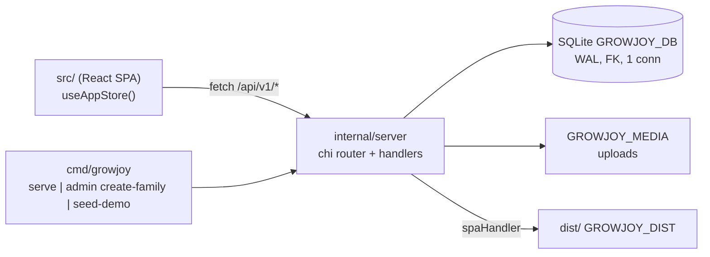

# Repository Guidelines

GrowJoy (`growjoy`): a family growth-task + points-reward H5 app. One Go binary serves the JSON API, session auth, protected uploads, and a prebuilt React SPA. UI copy, demo data and all of `README.md`/`docs/` are Chinese — write new user-facing strings in Chinese.

## Project Overview

- Purpose: parents define tasks/rewards; children complete tasks, earn points, redeem wishes. Per-family multi-tenant, single process, single replica (one SQLite file + one media dir on one persistent volume).
- Two runtimes, one deployable: Go 1.22 chi service (`cmd/growjoy`, `internal/server`) + React 19/Vite SPA (`src/`) that the same binary serves from `dist/`.
- The served family is never requested by the client: `resolvedFamily` takes the oldest `families` row, so the app is single-family in practice. `POST /auth/child` answers 409 `no_family` when the database has no family.
- Gate list = `make precommit` (`go vet ./...` + `go test -race ./...` + `npm test` + `npm run build`). It runs on every deploy: `make deploy` depends on `make precommit`, so a local deploy cannot ship a red tree — the local pre-commit hook (`.githooks/pre-commit`, `make install-hooks`) runs the same target but only exists on machines that opted in. The two Playwright gates (`check:flow`/`check:ui`) run manually via `make check`, never in the deploy path, and there is no CI at all. No linter or Dockerfile exists (`make fmt` is a plain `gofmt -l -w cmd internal`, not a gate), and the npm/go commands are driven directly; the root `Makefile` wraps them for local use (`make help` lists every target, `make dev` runs the Go server and Vite together) and adds these non-wrapper targets: `make deploy`, `make fmt`, `make logs`, `make stop`, `make clean`, `make distclean`. `make deploy` (precommit gate + cross-compile + rsync + `systemctl --user restart`, documented in `DEPLOY.md`) is the only deploy path, run by hand from the build machine — never two at once, because two rsyncing and restarting one single-replica box would mix `dist/` and binary — and it keeps `bin/growjoy.prev` + `dist.prev` on the host so a failed post-restart readiness/version/entry check restores both. The SPA entry it verifies is parsed out of `dist/index.html`, not guessed from `dist/assets/*.js`. Match surrounding formatting by hand.

## Architecture & Data Flow

**Backend layout.** Exactly two non-test packages: `cmd/growjoy` (CLI only) → `internal/server` (everything else). There is no `internal/store`, no service/repository layer. `server.go` holds `Config`/`Server`, `Open`/`applyMigrations`, the whole chi router, every write handler, auth, uploads and the DTOs; `state.go` holds the `/state` read side (`ensureInstances`, `weekStart`, `streaks`, `state`/`getState`); `stats.go` holds `GET /stats` end to end (`statsWindow`, `scheduledTaskCount`, the `stats` handler); `admin.go` holds non-HTTP operations (`CreateFamily`, `SeedDemo`, `EnsureDemo`); `games.go` holds the Klotski resource (the 5 built-in layouts and their sequential unlock rule, `getKlotski`/`completeKlotski`, and `klotskiShortest` — an in-process BFS that computes each level's moves floor once; `getKlotski` ships that same floor per level as `minMoves`, so the UI labels 最少 N 步 and cross-checks the client hint against the number the complete endpoint enforces); `quizzes.go` holds the quiz-game resource (口算闯关 `timed_calc` + 找规律 `pattern_quiz`: the `quizGames` spec table — name, score→point divisor, score ceiling — `getQuizzes` (today/all-time best, today's plays and the last 20 rounds per child) and `submitQuizScore`, which writes one `game_history` row per round and credits that round's FULL score (`awarded = score ÷ the spec's unit`, so every round pays even when it is not a record; `game_scores` keeps the day's best only for display; the ledger `reference_id` carries the round's history id, so each round is one ledger row) — it REQUIRES an `Idempotency-Key` because a re-sent round would otherwise pay twice); `homework.go` holds the homework resource (DTOs, the day read, the parent-side multipart writes, the fixed subject list and the image normalisation: EXIF orientation → longest edge 2560 → JPEG q85); `ratelimit.go` holds the token buckets, the argon2 slot gate, `recoverPanic` and the error helpers; `migrations/*.sql` is `//go:embed`-ed. Split by resource, not one file per handler: a new read-only surface belongs with its siblings (`state.go`/`stats.go`), a new resource gets its own file like `homework.go`.

**Middleware chain.** `requestLog` (security headers `nosniff`/`DENY`/`same-origin`, then one access line) wraps `recoverPanic` (a handler panic becomes a logged 500, and a response already written is not rewritten) wraps the mux. `/health/live`, `/health/ready` sit outside the API; `r.Route("/api/v1", ...)` applies `sameOrigin`; the public auth routes add `s.authLimit`; a nested group applies `authenticate`; role gating is `s.parentOnly(h)` or an inline actor check. No timeout middleware, no CSRF token, no CORS headers, no `Cache-Control`: CSRF rests on `sameOrigin` (GET/HEAD/OPTIONS pass; `Sec-Fetch-Site: cross-site` → 403 `cross_site_request`; a non-empty `Origin` whose host != `r.Host` → 403 `origin_mismatch`) plus `SameSite=Lax`. The check compares `Origin` with `r.Host`, so any proxy in front MUST preserve the browser's `Host` — this is why the Vite dev proxy sets `changeOrigin: false`.

**Routes** (`Handler`'s `/api/v1` group; `+auth` = `authenticate`, `+parent` = `parentOnly`, both after `+sameOrigin`):

| Route | Middleware | Actor | Success | Notable failures |
|---|---|---|---|---|
| `GET /health/live`, `GET /health/ready` | requestLog, recoverPanic | none | 200 `{"status":"ok"}` (live adds `version`) | ready: 503 `unavailable` (`"database unavailable"`, or `"runtime timezone data unavailable"` when the family timezone cannot load) |
| `POST /api/v1/auth/child` | +authLimit | none | 200 `{role,activeChildId}` | 409 `no_family`, 429 `too_many_requests` |
| `POST /api/v1/auth/parent` | +authLimit | none | 200 `{role:"parent",activeChildId}` | 400 `invalid_request`, 401 `invalid_credentials`, 429, 503 |
| `POST /api/v1/auth/parent/password` | +auth +parentOnly | parent | 204 | 400 `invalid_request`, 401 `invalid_credentials`, 429, 503 |
| `GET /api/v1/state` | +auth | any | 200 full `State` | 401 `unauthorized` |
| `PATCH /api/v1/session/child` | +auth | any | 204 | 400, 404 |
| `POST /api/v1/children/`, `PUT/DELETE /api/v1/children/{id}` | +auth +parent | parent | 200 `{id}` / 204 | 400, 404, 409 `last_child` |
| `POST /api/v1/children/{id}/points` | +auth +parent | parent | 200 `{id}` | 400 `idempotency_required`/`invalid_request`, 403, 404, 409 `insufficient_balance` |
| `POST /api/v1/tasks/`, `PUT/DELETE /api/v1/tasks/{id}` | +auth +parent | parent | 200 `{id}` / 204 | 400 (an element of `repeatWeekdays` outside `0..6` is `repeatWeekdays must be between 0 and 6`), 404 |
| `POST /api/v1/tasks/{id}/submit` | +auth | **child only** | 200 `{id}` | 403, 409 `invalid_state`/`conflict`, 413 `upload_too_large`, 415 `unsupported_media`, 400 `too_many_files`/`idempotency_required` |
| `POST /api/v1/tasks/{id}/review` | +auth +parent | parent | 200 `{approved}` | 400 `idempotency_required`, 409 `invalid_state`. The `note` of a rejection is stored on the submission (30 runes) and comes back to the child end as `submission.reviewNote` |
| `POST /api/v1/wishes/`, `PUT/DELETE /api/v1/wishes/{id}` | +auth +parent | parent | 200 `{id}` / 204 | 400, 404 |
| `POST /api/v1/wishes/{id}/redeem` | +auth | **child only** | 200 `{id}` | 403, 400 `idempotency_required`, 409 `wish_unavailable`/`insufficient_points` |
| `GET /api/v1/homework/?date=` | +auth | any | 200 `{date,items,holiday?}` (homework + media for one family-local date; `date<=? AND end_date>=?` so one day of a holiday shows the whole range's entries; `holiday` is that day's continuous rest block; default the family's today) | 400 `invalid_request`, 401 |
| `POST /api/v1/homework/`, `PUT/DELETE /api/v1/homework/{id}`, `DELETE /api/v1/homework/{id}/media/{mediaID}` | +auth +parent | parent | 200 `{id,skipped}` / 204 (writes take an optional `end_date`, defaulting to `date`) | 400 `invalid_request` (`end_date must be YYYY-MM-DD` / `end_date must not be before date` / `date range is too long`), 404 `not_found`, 413 `upload_too_large` |
| `POST /api/v1/homework/{id}/done` | +auth | any | 200 `{id,awarded}` (JSON `{date, done}`, the child card's 完成 checkbox; each subject done that day credits 5 points, all of that day's subjects done adds 5 more, `awarded` is the delta and un-checking reverses it) | 400 `invalid_request` (`date must be YYYY-MM-DD`, `no child selected`, or a date after the family-local today — a holiday range cannot be ticked ahead of time), 404 `not_found` (id outside the family, or a date outside `date..end_date`) |
| `PATCH /api/v1/redemptions/{id}` | +auth | **child only** | 204 | 403, 404 `not_found`, 413 `upload_too_large`, 415 `unsupported_media`, 400 `too_many_files` |
| `GET /api/v1/media/{id}` | +auth | any | bytes, `Content-Disposition: inline`, ranges via `http.ServeContent` | 404 `not_found` (outside the family; a task/redemption attachment also 404s for a child actor that is not its owner — only the parent end reads across children, `homework_media` stays family-wide) |
| `GET /api/v1/stats` | +auth | any | 200 stats for `?from`/`?to` (inclusive family-local dates; default the trailing 7 days) | 400 `invalid_request`, 401 |
| `GET /api/v1/games/klotski` | +auth | any | 200 `{levels, completed}` — the 5 built-in layouts in order, each with `minMoves` (the same per-level BFS floor the complete endpoint enforces, shipped even when uncompleted) plus `unlocked`/`completed`/`bestMoves` for the selected child | 400 `invalid_request` (no child selected), 401 |
|`POST /api/v1/games/klotski/{level}/complete`|+auth|any|200 `{id:"klotski:<level>", awarded}` — first clear credits 30 once (`INSERT OR IGNORE` on the `klotski_progress` PK + one `reward` ledger row), a replay awards 0 and only refreshes `best_moves` when lower|404 `not_found` (level outside 1…5), 400 `invalid_request` (`moves` outside `klotskiShortest(level)..10000` — the floor is BFS-computed per layout, never a hand-tuned constant — or no child selected), 409 `invalid_state` (previous level not completed)|
|`GET /api/v1/games/quizzes`|+auth|any|200 `{games, history}` — both quiz games in fixed order (口算闯关 first), each `{game,name,todayBest,allTimeBest,todayPlays,level}`, plus the selected child's last 20 `game_history` rounds|400 `invalid_request` (no child selected), 401|
|`POST /api/v1/games/quizzes/{game}/score`|+auth|any|200 `{awarded}` — one `game_history` row always; every round credits its own score (one point per correct answer: `timed_calc` 1 question = 1 point, `pattern_quiz` its 10-point scale ÷ 10) and `game_scores` only tracks the family-local day's best for display, ledger `reference_id` `<game>:round:<historyID>`|404 `not_found` (game outside the CHECK set), 400 `idempotency_required`, 400 `invalid_request` (`score` outside the game's scale — `pattern_quiz` only in multiples of 10 — `level` outside 1…3, missing/out-of-range `mistakes` 0…20 for pattern, `seconds ≠ 60` for calc, no child selected), 409 on replay semantics via `Idempotency-Key`|
| `*` | requestLog, recoverPanic | none | existing file, else `index.html` 200 | never 404 (a missing asset, `/favicon.ico` included, returns `index.html`) |

`submit`/`redeem` reject a parent actor (`403 forbidden "child access required"`) and `review` is registered `parentOnly`, so a session can never do both. `PATCH /redemptions/{id}` copies the same three actor guards inline (there is no `childOnly` middleware) and is `multipart/form-data` (field `completed`, optional `note` + `files`, same sniffing/limits as submit): it writes `completed_at`/`completed_note` plus `attachments.redemption_id` as **one** completion record, and `completed=false` clears all three (rows deleted, files removed after commit). It deliberately takes **no** `Idempotency-Key`: no ledger row and no `children` column is touched, and a replay only re-creates evidence rows. The three create routes are subrouter `/` routes: `src/store.ts` always emits the trailing-slash form.

**Data flow.** The SPA never loads resources individually: `GET /api/v1/state` returns the whole `State` aggregate (role, active child, children, tasks, submissions+attachments, wishes, ledger, redemptions, family `timezone`) and `/stats` a separate payload. Mutations return `{"id":"..."}` (200) or 204, and `src/store.ts` re-fetches both, and its `childTasks` memo (which every task list and its counters read) hides instances that are `completed` **and** dated before the family's today — the task lists are "what to do now", past completions belong to the growth calendar, while `todo`/`pending_review`/`rejected` instances from any day stay visible for the parent who still has to confirm them. No optimistic updates — the server is the source of truth. `State.timezone` is the family's IANA zone (`loc.String()` from `familyLocation`), which the child growth calendar MUST use to turn UTC instants into family-local `YYYY-MM-DD` — a device-local date would disagree with `due_date` and `/stats` near midnight.

**Reads write.** `state()` calls `ensureInstances(ctx, family)`, which materializes `task_instances` for today (`daily`), the current ISO Monday week (`weekly`, `due_date` = Monday + `(repeat_weekday+6)%7` days, `period_key` = Monday) or the creation date (`once`, `period_key = "once"`) with `INSERT OR IGNORE` + `UNIQUE(template_id, period_key)`. Day/week buckets use the family's IANA timezone (`Asia/Shanghai` default). `state()` output order is a UI contract: children/ledger/redemptions/submissions ascending, tasks and wishes `created_at DESC`, every slice normalized to a non-nil array.

**Invariants to preserve (all enforced in SQL, never in app locks).**
- Every statement carries `family_id` from the session row; `RowsAffected() == 0` → 404. A query missing `AND family_id = ?` is a cross-family leak. Child-scoped reads use the literal `AND (? = 'parent' OR child_id = ?)` bound to the actor type + selected child.
- Exactly-once effects: `point_ledger UNIQUE(family_id, reference_type, reference_id)` + `INSERT OR IGNORE` with a `RowsAffected()==1` guard before crediting growth, status-guarded `UPDATE ... WHERE status IN ('todo','rejected')` (`changed != 1` → 409 `conflict`), `reviewTask`'s two status asserts (submission `UPDATE ... WHERE reviewed_at IS NULL`, instance `UPDATE ... WHERE status='pending_review'`, each with its own `RowsAffected()!=1` → 409 `conflict`) so a second review can never re-credit, `task_instances UNIQUE(template_id, period_key)` (a multi-weekday `weekly` template gets one instance per weekday with `period_key` = `<周一>:<星期>`, while an empty `repeat_weekdays` — every row written before 007 — keeps the bare `<周一>`, so `ensureInstances` must keep producing exactly that key for legacy rows; `scheduledTaskCount` reads the same set), `homework_done PRIMARY KEY(homework_id, date, child_id)` (one tick per subject-day **per child**, 009) with homework ledger keys `<homework>:<date>:<child>` / `<date>:<child>` so two siblings ticking the same holiday day each earn their own points and the day bonus is per child, `game_scores PRIMARY KEY(family_id, child_id, game, date)` + quiz ledger key `<game>:round:<historyID>` (one daily-best row per child per game, kept only for display; each round pays its own score and its own ledger row), `INSERT OR IGNORE` keys, and `idempotency_keys PRIMARY KEY(family_id, actor_id, operation, key)`.
- `POST /tasks/{id}/submit`, `/review`, `/wishes/{id}/redeem`, `children/{id}/points` and `games/quizzes/{game}/score` REQUIRE an `Idempotency-Key` header (else 400 `idempotency_required`); a replay returns the stored status with `{"replayed": true}` and MUST NOT repeat side effects. `claimIdempotencyKey` takes the key as the transaction's FIRST write (`INSERT ... ON CONFLICT DO NOTHING`, sentinel `status_code = -1`), so a concurrent same-key request cannot run the effects twice: the loser's INSERT conflicts, its transaction rolls back, and it answers the stored status. A loser that finds the sentinel (or no row, because the winner rolled back) gets 409 `conflict` instead. `submit` reads the instance state only after the claim, so a same-key retry replays the stored 200 rather than tripping over the status the first attempt already moved. `status_code` is the only column ever read back (`response_body` is write-only).
- `streaks` reads at most `streakLookbackDays` (400) of ledger history per child — the window, not the whole life of the family, is what `/state` pays for on every request. `children.experience` is a `REAL` column scanned into a `float64` and floored to `int` before `% 100`/`level`, so one fractional value cannot break `/state` with a scan error. `verifySecret` rejects a stored argon2 hash whose cost parameters fall outside 8 MiB·1 iteration…256 MiB·10 iterations, because those parameters come from the row, not from the process.
- The pool is `SetMaxOpenConns(1)`: close each `*sql.Rows` before the next query. Pragmas (`WAL`, `foreign_keys=ON`, `busy_timeout=5000`) are applied once at `Open` on that single connection, so raising the limit silently drops all three — `deleteChild`'s `ON DELETE CASCADE` depends on `foreign_keys`.
- Internal failures NEVER reach the client: use `s.internalError(w, r, err)` (or `s.uploadError`, which keeps the `upload_failed` code) — it logs method/path/error via `s.log` and answers `{"error":{"code":"internal","message":"internal server error"}}`. Never pass `err.Error()` to `problem(...)`. `/health/ready` likewise answers a bare "database unavailable".
- Auth is throttled on two independent budgets (`ratelimit.go`'s const block): `authIP` (60 burst / 1 per second per client address, applied by `s.authLimit`) protects the process; `authFailures` (10 burst / 1 per 30 s per family actor) protects the parent password, the app's only credential. The failure budget is charged ONLY after a wrong password (check → charge → 401), so the family is never locked out of its own parent end — do not move that check before verification. `clientAddr` deliberately ignores `X-Forwarded-For`; buckets are evicted only by `Sweep` (idle > 30 min).
- The child end is the default: `POST /auth/child` opens (or reuses) a child session, demoting a parent session by deleting its row; `POST /auth/parent` verifies the submitted password against each of the family's parents in `created_at,id` order and binds the session to the match; `PATCH /session/child` switches profile for both actor types and, for a child session, rewrites `actor_id=selected_child_id`. A child session mirrors its profile in `actor_id`, so the scoping form and the per-child idempotency keys stay exact. Parent authority is per visit: a reload starts the child end again and the password gate is client-side state (`Shell`'s `parentGate`) backed by a 12 h parent session (child sessions last 30 d).
- Every argon2 call goes through `s.hashPassword` / `s.verifyPassword`, which serialize on a 4-slot gate (`argon2Slots`) because each call allocates 64 MiB. Direct calls to `hashSecret`/`verifySecret` bypass that bound.
- Points are double-bookkept: ledger is truth; `children.experience` is **total** experience, the API exposes `experience % 100` and `level = 1 + total/100`, approval adds `max(points/5, 1)` and recomputes the level from the new total. `children.points_balance` may go **negative**: un-checking a homework deducts the points it earned even if the child already spent them (the ledger row remembers which child earned it, so a sibling's untick cannot take the other child's points) (006 rebuilt `children` to drop the old `CHECK(points_balance>=0)`; SQLite cannot alter a CHECK, and the rebuild only works because `runMigration` turns `PRAGMA foreign_keys` OFF on the pool's single connection before the transaction and back ON after it — the seven tables keep `ON DELETE CASCADE` clauses pointing at `children`, so with FKs on the rebuild's `DROP TABLE children` really empties them (that is how the deployed family lost every task, submission and ledger row on 2026-11-05). `PRAGMA defer_foreign_keys=ON` does NOT prevent that; never restore it.) A wish redemption still refuses (`409 insufficient_points`) unless `points_balance>=points_cost`, so a negative balance can never be redeemed against.

**Frontend shape.** `main.tsx` → `App` → `BrowserRouter` with a catch-all route rendering `Shell`. `Shell` calls `useAppStore()` **once** and passes the whole store object down as a `store` prop; it picks child vs parent shell from `location.pathname.startsWith("/parent")` plus `state.role`, and gates on `ready`/`connected` plus a `parentGate` password modal (a `/parent` deep link is stashed and restored after unlocking). While the parent end is unlocked the account menu (`.role-menu`, visible at every width, unlike `.sidebar-bottom`) also grows a 修改家长密码 entry that renders `ParentPasswordModal` — a `TaskForm`-shaped `.form-modal`, deliberately not `.pin-modal`, whose wrong-current-password branch is a 401 the store MUST NOT replay; that is why the route sits under `/auth/`. Route tables: `ChildLayout` (`/child`, `/child/tasks`, `/child/homework`, `/child/wishes`, `/child/ledger`, `/child/growth`, `/child/games`, `/child/games/klotski` (`?level=`), `/child/games/calc`, `/child/games/pattern`, `*` → `/child`) and `ParentLayout` (`/parent`, `/parent/children`, `/parent/tasks`, `/parent/wishes`, `/parent/homework`, `/parent/games`, `/parent/stats`, `*` → `/parent`). The child bottom nav therefore has five tabs, which is why `.bottom-nav a{min-width}` is 58px (积分明细 is not a sixth tab — it is reached from the balance card). `src/features/ledger.tsx`'s `ChildLedger` renders `/child/ledger` from `state.ledger` alone (no new endpoint): the child's own rows newest-first under family-local `.ledger-day` heads, a `.ledger-total` header (balance + `共 N 笔记录`), rows reusing the parent overview's `.activity-list`, and each row's `.ledger-after` 结余 comes from `balancesAfter` — walk the newest-first list subtracting each amount from the current `pointsBalance`, so the newest row's 结余 is the balance by construction. The 我的积分 card's 积分明细 link (`.balance-link`) is that screen's only entry. Level-ups are the second reward channel: `Shell` keeps a per-child level baseline with the same base-on-first-state semantics as the reward queue (and ignores the parent end), so a `level` increase answers exactly once on the child end as a `LevelUpToast` (`.level-up`, `pointer-events:none`, auto-dismiss 3.6 s, no close button — deliberately not `.reward-celebration`, which is a click-through queue). `WishCard` prints `.wish-progress` (bar + `已攒 N/C 积分` aria-label, both clamped to 0..cost so a negative balance cannot draw a negative bar) and swaps 去兑换 for a disabled `还差 N` button when the child cannot pay yet; `WishMini` swaps 继续努力 for `还差 N`. `/child/growth`'s achievement card also renders a `.badge-row` of six `.badge-chip`s (3/7/14/30/60/100 consecutive days, `locked` below the threshold) and its copy names the next badge in `再坚持 N 天` terms. `ChildHome` itself leads with the homework module: `TodayHomework` (今日作业 heading + 按日期查看 link + the daily proverb banner + that day's cards or the empty state) sits directly under the greeting, above the growth-partner hero. It always shows the family-local today — arriving from `/child/homework` after browsing another date re-loads today instead of showing the stale day — and its cards plus the full-screen lightbox are the same `HomeworkDay` component the dated screen renders, so the two surfaces cannot drift apart. Both child surfaces pass `HomeworkDay` an `onDone`, which renders the per-card 完成 checkbox (`.homework-check`, `.homework-card.done`); `Homework.done` is the flag for **the day on screen**, not for the whole entry, so a holiday-range homework can be ticked day by day — the store's `toggleHomeworkDone` flips the row locally first (a reload would snap the controlled box back while the request is in flight) and `POST /homework/{id}/done` is idempotent on the done row (`INSERT OR IGNORE` / `DELETE` plus a `RowsAffected()==1` gate), so it takes no `Idempotency-Key`; the two ledger entries it writes are keyed per child (`reference_type` `homework` with `reference_id` `<id>:<date>:<child>`, and `homework_bonus` with `reference_id` `<date>:<child>`), and `homework_done` carries `child_id` itself (009), so two siblings ticking the same holiday day each earn their own 5 points instead of sharing one row; only a real state flip credits 5 points per subject (+5 once *that child* has every subject of the day done) and un-checking deletes those rows and claws back exactly what that child earned (the balance may end up negative; a redemption still needs full funds). The checkbox is `disabled` while its own POST is in flight, and a failed tick rolls the optimistic flip back because `refresh()` only re-reads `/state` — the credit surfaces through the normal `RewardCelebration` ledger queue **and** as an in-card `+N` pill (`.homework-award`): `run` returns the operation's value, so `toggleHomeworkDone` hands the response's `awarded` back to `HomeworkDay`, which owns the pill in local state for 2 s (`aria-hidden` — the banner already announces it) and never guesses the number client-side; un-checking clears the pill and the reversal surfaces through a `已取消完成，扣回 5 积分` toast. The parent end renders the same items without that checkbox. The child `TaskCard` collects nothing: 完成任务 / 重新提交 post `POST /tasks/{id}/submit` on the spot (one tap → `pending_review`), guarded by a local `busy` flag on the button — there is no submit panel, no `note`, no file picker, and a mis-tap can only be undone by the parent's 退回 (no un-submit endpoint for `todo`). Submitted evidence is rendered by one shared `SubmissionEvidence` (fed by `store.latestSubmissions`, the newest submission per task for the child on screen) in both the child `TaskCard` and the parent `AdminTaskRow`: images become `.media-thumb` thumbnails that open a `.media-viewer` overlay, videos become inline `.media-video` players, and any attachment without a `url` (local `File` entries before upload, `data.ts`/vitest seeds, a file the browser cannot decode) falls back to the plain `.attachment-chip` label. Because a task submission now carries no note and no media, a submission with **neither** renders only its `.evidence-heading` line (我提交的内容 + the family-local submitted time) — the `未填写文字备注`/`未添加照片或视频` placeholders are gone; note and media still render for demo-seeded and legacy rows. Redemptions are rendered by one shared `StarWishList`/`StarRow` on both ends: the child `/child/wishes` screen feeds it `store.childRedemptions` (its own rows, newest first) and `/parent/wishes` feeds it the reversed `state.redemptions` with `ownerName` — read-only, no `onToggle`. Only the child row gets the 标记完成 panel (`note` + `image/*`/`video/*` pickers — the only place in the app that still collects evidence for a write; the textarea is capped at 30 runes like the server, `确认完成` disables itself while the PATCH is in flight and the panel closes only after it succeeds, and a repeat 确认完成 replaces that redemption's attachments instead of appending to them) and the 撤销完成 confirm; a `completedNote`/`attachments` pair is rendered under the line by `MediaGallery`, and the row's dimming is applied to the line only (`.star-done>.star-line`) so the confirm modal is never trapped in the row's stacking context — and `.star-done>.star-evidence` is deliberately **not** dimmed for the same reason: `opacity` would create a stacking context around the block the `.media-viewer` is opened from, and the `position:fixed` overlay would then paint under the 68px sticky `.topbar` (`z-index:30`), leaving 关闭预览 unclickable. The topbar carries a 刷新 icon button (`.refresh-button`, aria-label/title 刷新) on both ends: `store.actions.refresh()` re-fetches `/state` + `/stats` and re-loads the homework date on screen inside `run`, shows a 「已刷新」 notice, and removes it 2 s later only if it is still that exact message (so a failure that replaced it is never wiped); `check:flow` asserts one click re-fetches `/state`, paints the 已刷新 toast (found by `role="status"` + text, not by a class) and that the toast is gone again within 2 s. The parent overview's 奖励积分 button opens `PointsForm` (`增加积分`/`扣除积分` toggle, integral `积分数量` 1–500 with 5/10/20/50 presets, optional 30-rune `原因`, 「确认奖励」/「确认扣除」), which posts that signed amount through `store.actions.awardPoints` — the same ledger as task approval, except a deduction only lowers the balance. Both viewers (the evidence `.media-viewer` and the homework viewer) are CSS overlays only — they deliberately do NOT call the browser Fullscreen API, which in the Android WebView rotated the screen on every tap; their `<video>`s carry `playsInline` for the same reason. Both embed the same `ZoomableImage` (pinch, double-click, wheel and `放大`/`缩小`/`重置` buttons in `.zoom-controls`, current zoom mirrored to `data-scale`): a zoomed image pans, and the homework swipe handler checks that scale so a swipe released while zoomed pans instead of changing the image.

**Both ends share one screen, so nothing there is static.** `useAppStore` re-runs `pull(true)` every `autoRefreshMs` (60 s) and only while `document.visibilityState === "visible"`; `keepRole` exists because `request()` re-opens the child end when a parent session has expired, and a poll nobody is watching must not throw the parent off the page (a half-filled form would vanish with it). `ParentLayout`'s 任务管理 link grows a `.nav-badge` with the `pending_review` count, and `ParentOverview`'s 需要你的确认 header grows a 全部确认 button (only when more than one) behind a ConfirmModal (确认全部) that calls `store.actions.reviewAll(ids)` — deliberately **sequential** `POST /tasks/{id}/review` calls, each with its own `Idempotency-Key`, each swallowing its own error into a skipped count, because a batch endpoint would need a new ledger/idempotency story for something a parent taps once a week. Rejecting is now a two-step `.review-actions.rejecting` row (`input.review-note`, 30 runes, 确认退回 disabled while blank) — a 退回 with no reason was the least actionable thing in the app — and the stored reason prints back on the child's card as `.review-note-line` (`家长：…`). Two more form affordances, both frontend-only: `TaskForm` create mode renders `taskPresets` (`.preset-list` → `.preset-chip`, 3 categories × 5 items, `title` carries the description) that only pre-fills fields and never creates, and a `weekly` task picks several weekdays (`.weekday-chip` × 7 plus `.weekday-quick` 工作日/周末/全选, submit disabled when none is checked), with `repeatWeekday` demoted to “the first checked day”.

**Family-local dates only.** `ChildHome`'s greeting, `TaskCard`'s due label, `StarRow`'s redemption date, `DayTaskRow`'s 原定 badge, the ledger/submission timestamps and `TaskForm`'s default weekday all go through the helpers next to `dateText` (`familyToday`/`familyDate`/`weekdayOf`/`weekdayIndex`/`monthDayText`), which read the family's IANA zone. A device-local `new Date().toISOString().slice(0,10)` loses the last 8 hours of a Shanghai day and disagrees with `due_date` and `/stats`. Any component that needs today takes a `today`/`timezone` prop instead of reading the clock itself (`TaskCard`, `DayTaskRow`, `StarWishList`/`StarRow`, `TaskForm`); adding one more `new Date()` to a render is the bug this list exists to prevent.

**Server-side analytics.** `GET /stats` is computed for `x.SelectedChildID` only — it is not a family aggregate — over the window `?from`/`?to` name (inclusive family-local `2006-01-02` dates; `statsWindow` defaults to the trailing 7 days and answers 400 `invalid_request` for one end only, `from > to`, an unparseable date or a span over `statsMaxRangeDays` (92)). `totalTasks` is **derived from the templates** (`scheduledTaskCount`: `daily` once per day from its creation day clamped to the window, `weekly` only on its `repeat_weekday`, `once` on its creation day, `active=1` templates only) because `ensureInstances` materializes only the day or week that was read, so an instance-based count is 0 in every historical window. `completedTasks` counts the `approved=1` submissions reviewed inside the window, the ledger sums use the same window, `daily` carries one bucket per day — `周日..周六` when the span is ≤ 14 days, else `M/D` — and `categories` is derived from those confirmations (count descending, then name) so a family's own category names survive. The payload echoes `from`/`to`. The child `Growth` screen does NOT consume it. It renders a **growth calendar** derived entirely from `State`: `familyDate`/`dayDigest`/`dayActivity` (`src/domain.ts`) bucket `tasks` by `dueDate` and submissions/ledger entries by their family-local date, so a day shows its scheduled instances with status plus a 「补录记录」 group for tasks whose newest submission lands on another day than the instance's `due_date` (exactly one day per task — the newest submission wins, matching the server's `submitted_at` order); the calendar dots are `backfill` if that day received a backfill, else `done` when every scheduled instance is completed, else `open`. Every cell also prints its 农历 day (a 节日 name replaces it) and, in the corner, a 「休」/「班」 mark from `State.holidays` + `State.makeupWorkdays` — weekends count as 休 unless the table lists them as 调休上班日 (`src/lunar.ts`); the same `LunarTag` sits under the day-panel heading, the child home greeting and the homework date bars. `ParentStats` is its only consumer, and it requests its own window through `store.actions.loadStats` instead of reading the default snapshot in `store.stats`; its effect keys on `activeChild.id` + the range (not the whole `store.state`), so the 60 s poll does not re-ask for the same window. The parent `completedTasks`/ledger reads are bounded in SQL (`reviewed_at`/`created_at` between the window's UTC bounds), so an old family does not pay for its whole history on every `/stats`.

## Key Directories

|Path|Purpose|
|---|---|
|`cmd/growjoy/main.go`|Sole `main`: subcommand dispatch (`serve`, `admin create-family`, `seed-demo`, `backup`, `gc`), the only reader of `GROWJOY_*`, `http.Server{ReadHeaderTimeout: 10s}` + SIGINT/SIGTERM graceful shutdown, hourly `Sweep` ticker.|
|`internal/server/`|Entire backend: HTTP, auth, SQLite, uploads, DTOs and every write handler (`server.go`), the `/state` read side (`state.go`), `/stats` (`stats.go`), the homework resource (`homework.go`), the Klotski resource (`games.go`), the quiz-game resource (`quizzes.go`), auth throttling/argon2 gate/panic recovery/error helpers (`ratelimit.go`), non-HTTP operations (`admin.go`).|
|`internal/server/migrations/`|`001_init.sql` (schema of record: 13 tables, CHECK constraints, uniqueness keys, indexes; the 002–006 ALTER chain was flattened into it before the first deployment) plus `002_homework.sql` (`homework` / `homework_media`, 15 tables total), `003_hot_path_indexes.sql` (`attachments(family_id,submission_id)` + `point_ledger(family_id,created_at)` — the two reads `/state` makes on every request), `004_homework_range.sql` (`homework.end_date`, backfilled from `date`, plus `(family_id,end_date)` for the range read) and `005_homework_done.sql` (`homework_done`, one row per homework per family-local day, `PRIMARY KEY(homework_id,date)`, `ON DELETE CASCADE` from `homework`) and `006_negative_balance.sql` (rebuilds `children` without `CHECK(points_balance>=0)` so un-checking homework can leave a negative balance), `007_task_repeat_weekdays.sql` (`task_templates.repeat_weekdays` + `task_instances.repeat_weekdays`, both `TEXT NOT NULL DEFAULT ''`; the value is an ascending deduped comma string of `0`..`6` and an EMPTY STRING means “only `repeat_weekday` that day”, i.e. every pre-007 row keeps its old meaning and its old `period_key`, which is why nothing is backfilled) and `009_homework_done_child.sql` (rebuilds `homework_done` with `child_id TEXT NOT NULL REFERENCES children(id) ON DELETE CASCADE` and `PRIMARY KEY(homework_id,date,child_id)`; each old row is backfilled from the `point_ledger` row that earned it, else from the family's oldest child, and rows of a family with no child left are dropped; the existing `homework`/`homework_bonus` ledger `reference_id`s are then suffixed with `:<child>` so the unique key still holds) and `010_klotski.sql` (`klotski_progress`: one row per child per level with `PRIMARY KEY(family_id,child_id,level)`, `level CHECK(level BETWEEN 1 AND 5)` and `best_moves CHECK(best_moves>0)`, cascading from `families`/`children`; the PK + `INSERT OR IGNORE` is what makes the 30-point first-clear credit exactly once per level) and `011_quizzes.sql` (`game_history`: one row per finished quiz round — `id TEXT PRIMARY KEY` (`id("hist")`), `score CHECK(score>=0)` and the `game IN ('timed_calc','pattern_quiz')` CHECK the score route's 404 leans on, `details` carries the per-round JSON, index on `(family_id,child_id,created_at)` — plus `game_scores`: one family-local daily-best row per child per game, `PRIMARY KEY(family_id,child_id,game,date)`, `best_score>=0`, `level 1..3`, `plays>0`; both tables cascade from `families`/`children`). There is no 008: it was written and reverted the same day, so its number must never be reused — a database that ran the reverted 008 keeps its two columns and a `schema_migrations` row 8, and a future 8 would be silently skipped (the next migration is therefore ≥ 012, and 010 and 011 are used). The 假期 table (`internal/server/holidays.go`) stops at 2027 and degrades to weekend merging beyond it, so it needs next year's entries added every November–December (the State Council publishes the next year's notice in early November; the 2027 one is 国办发明电〔2026〕10号, released 2026-11-05). Versions ≥ 2 run once each through `runMigration` (`server.go`), which wraps them in a transaction and toggles `PRAGMA foreign_keys=OFF`/`ON` around it: a rebuild that `DROP`s a table other tables reference with `ON DELETE CASCADE` would otherwise cascade-delete real data, and `defer_foreign_keys` is no defence against it — `TestLegacyDatabaseUpgradeKeepsEveryRow` guards this. Embedded at compile time.|
|`src/`|SPA: `App.tsx` (shells, routes and the task/wish/growth screens), `ui.tsx` (shared display primitives: `StarMark`, `useDialog`, `SectionTitle`, `Metric`, `PageHeading`, `EmptyState`, `ConfirmModal`, `ParentHeader`, `LunarTag`, `ZoomableImage`), `features/homework.tsx` (the homework set), `features/stats.tsx` (`ParentStats` + its range constants), `features/ledger.tsx` (`ChildLedger` + the `balancesAfter` 结余 walk), `features/games.tsx` (`GameTeaser` home card, `ChildGames` level picker, `KlotskiGame`/`KlotskiBoard` + `WinModal`, `ParentGames` progress), `features/quiz.tsx` (`CalcSprint` the 60-second 口算 screen, `PatternQuiz` the 10-question 找规律 screen, both finishing into a points overlay that shows the server's `awarded`, plus the shared 成绩 strip fed by `store.quizzes` and `ParentQuizzes` progress), `features/quizzes.ts` (the seed-random question generators: `makeCalcQuestion`/`makePatternRound` with the difficulty tiers, the four-option distractor rule and `patternOptions`), `features/klotski.ts` (the pure row-string helpers: `parseRows`/`targetsFor`/`applyMove`/`isSolved` + `pieceLabels`/`pieceIcons` (each piece's emoji face is UI decoration beside its Chinese label), the client-side hint engine `solveFrom` — a BFS over the **current** position (same shape-normalised encoding as the server's `klotskiShortest`) returning `{moves, steps}` in empty-cell notation with `emptyKeys` numbering the two blanks row-major per position and `stepToMove` translating a step back to the piece + landing cell so the board highlights them (`stepToMove` returns the char/anchor/arrow/cell the `.hint-from`/`.hint-cell` markers render from), so a hint always matches the board the child is actually looking at, plus `klotski.test.ts` pinning them), `store.ts` (state container + API client), `types.ts` (wire shapes + the write-input types), `domain.ts` (the growth-calendar day helpers plus the `shiftDate` range arithmetic the UI calls), `lunar.ts` (农历换算 + 「休」/「班」角标; the lunar date comes from the platform's `Intl` chinese calendar, the holiday marks from `State.holidays`/`State.makeupWorkdays`), `proverbs.ts` (the 30 annotated 每日谚语, each with pinyin and an English line, + `proverbForDate`), `data.ts` (demo seed), `styles.css`.|
|`scripts/`|Node ESM verification harnesses: `with-service.mjs` (boots a throwaway real server), `flow-check.mjs`, `visual-check.mjs`; plus `growjoy-backup.sh` (daily `backup` + 30-day rotation, driven by the systemd user timer in DEPLOY.md and synced to the host by `make deploy`).|
|`.githooks/pre-commit`|Local pre-commit fast gate (`make test build` = vet + `go test -race` + `npm test` + build); enabled by `make install-hooks` (`git config core.hooksPath .githooks`).|
|`dist/` (gitignored)|Vite output; the Go server serves it — must be rebuilt for SPA changes.|
|`data/` (gitignored)|Default `growjoy.db` + `media/`; created `0700`. Never commit.|
|`.artifacts/` (gitignored)|`ui/*.png` from **both** Playwright gates (`check:ui` writes 16 scenario PNGs, `check:flow` writes `evidence-child.png`, `evidence-parent.png`, `growth-day.png`, `growth-backfill.png`, `reward-queue.png`, `stats-range.png`, `points-award.png` and `homework-form.png`, `homework-holiday.png`, `wish-progress.png`, `ledger-page.png`, `games-progress.png` and `games-admin.png`); visual evidence, not versioned.|

## Development Commands

|Command|Effect|
|---|---|
|`npm install`|Installs deps from the committed lockfile (see versioning rules below).|
|`npm run dev:server`|`go run ./cmd/growjoy serve --demo` on `127.0.0.1:8080`; idempotently creates the DEMO family. No build needed.|
|`npm run dev`|Vite dev server (`:5173`) with `/api` proxied to `127.0.0.1:8080` (`vite.config.mjs`). Run alongside `dev:server`.|
|`npm run build`|`tsc -b && vite build` → `dist/` (`tsc -b` is typecheck-only: `noEmit`).|
|`npm test`|`vitest run` over `src/domain.test.ts` (the growth-calendar day helpers), `src/proverbs.test.ts` (the annotated proverbs + the day rotation), `src/lunar.test.ts` (the lunar date/festival mapping and the 休/班 marks), `src/features/klotski.test.ts` (the pure Klotski row helpers: layout parsing + sliding/`isSolved` + the `solveFrom` hint BFS) and `src/features/quizzes.test.ts` (the seed-random question generators: reproducible rounds, correct answers inside the four options, tier bounds, the pattern ladder and its sequences).|
|`npm run test:go` / `go test ./...`|Go tests (one package: `internal/server`).|
|`npm run check:flow`|`npm run build` then Playwright E2E against a real throwaway server: full child/parent journey with API-state assertions.|
|`npm run check:ui`|`npm run build` then 16-scenario screenshot/overflow gate → `.artifacts/ui/*.png`.|
| `npm run preview` | Static preview of `dist/` (default `:4173`); serves no `/api` proxy, so the harnesses cannot pass against it. |
| `make dev` | Wrapper: builds `data/growjoy-dev` and runs `serve --demo` on `127.0.0.1:8080` alongside `npm run dev` (`http://localhost:5173`), one Ctrl-C stops both. `make` / `make help` lists every target. |
| `make deploy` | Pushes a release to the deploy host in one command (`DEPLOY_HOST`/`DEPLOY_DIR`/`DEPLOY_URL`/`DEPLOY_UNIT`/`DEPLOY_STAGE`; the build machine is `dev` (192.168.0.211) while the target is another box (`DEPLOY_HOST` defaults to `192.168.0.208`, user `pengchang`, a systemd **user** unit), so the build machine's pubkey must be in that host's `~/.ssh/authorized_keys`): `make precommit` (vet + `go test -race` + `npm test` + `npm run build`), then `CGO_ENABLED=0 GOOS=linux GOARCH=amd64 go build -ldflags "-X main.version=$(git describe --always --dirty)"` into `DEPLOY_STAGE` (outside the repo), `rsync --delete` of `dist/`, `rsync` of the binary, `chmod +x`, `systemctl --user restart DEPLOY_UNIT`, then polls `/health/ready` and requires `/health/live`'s `version` to equal the local `git describe`. Never touches remote `data/`. First deploy still needs the manual provisioning in `DEPLOY.md`. |
| `make install-hooks` | Enables the local pre-commit hook: `git config core.hooksPath .githooks` (`.githooks/pre-commit` runs `make test build`). |
| `make precommit` | The fast gate the hook runs: `test` (vet + `go test -race` + `npm test`) + `build`; the two Playwright gates are not included. |
|`go build -o growjoy ./cmd/growjoy`|CLI binary for `admin create-family` / `seed-demo`; writes an untracked binary at the repo root, covered by `.gitignore`'s `/growjoy` line.|

Demo credentials (`serve --demo`): family `DEMO`, parent password `2468`. The child end needs no credential and is the app's default view; `/parent` is gated by the password on every visit. Three pinning traps: the server serves whatever currently sits in `dist/` (editing `src/` requires `npm run build`; no HMR through Go), the dev proxy hardcodes port 8080 — moving `GROWJOY_ADDR` requires editing `vite.config.mjs` too, and the proxy must keep `changeOrigin: false` or every POST is rejected with `403 origin_mismatch` (`check:*` scripts are immune: ephemeral port via `BASE_URL`).

## Code Conventions & Common Patterns

### Go

- Handlers are methods registered directly in `Handler()`: `func (s *Server) verbNoun(w http.ResponseWriter, r *http.Request)`. Files are split by concern, not one file per handler.
- Dual-purpose save handlers: `chi.URLParam(r, "id") == ""` means create, otherwise update (`saveChild`, `saveTask`, `saveWish`).
- JSON out: `writeJSON(w, status, v)`; errors ALWAYS via `problem(w, status, code, message)` → `{"error":{"code":"...","message":"..."}}` with snake_case codes — in use: `invalid_request`, `invalid_credentials`, `unauthorized`, `forbidden`, `not_found`, `invalid_state`, `too_many_requests`, `idempotency_required`, `upload_too_large`, `unsupported_media`, `too_many_files`, `insufficient_points`, `insufficient_balance`, `wish_unavailable`, `last_child`, `conflict`, `internal`, `upload_failed`, `unavailable`, `no_family`, `origin_mismatch`, `cross_site_request` — and internal ones through `s.internalError`/`s.uploadError`, never with the raw error text.
- JSON in: `decode(r, v)` — 1 MiB `io.LimitReader` **and** `DisallowUnknownFields()`; a client field absent from the Go input struct is a hard 400. Multipart submit and redemption completion read `r.FormValue("note")` instead, capped at 30 runes.
- Raw inline SQL with `?` placeholders. No ORM, no repository layer, no prepared statements. Scan into the exported DTOs (`Child`, `Task`, `Submission`, `Wish`, `Ledger`, `Redemption`, `State`) — camelCase `json` tags over snake_case columns; request bodies use unexported per-resource types (`childInput`, `taskInput`, `wishInput`) or inline anonymous structs.
- Multi-write flows use `tx, err := s.db.BeginTx(ctx, nil)` + `defer tx.Rollback()` + explicit `Commit()` — the exact set is `CreateFamily`, `SeedDemo`, `deleteChild`, `deleteTask`, `submitTask`, `reviewTask`, `redeemWish`, `completeRedemption`, `awardPoints`, `saveHomework`, `deleteHomework`, `setHomeworkDone` (done row + ledger + balance). Never touch `s.db` after `Commit()` in the same handler.
- Time: read `s.now()` — NEVER `time.Now()` in a handler, and never the process-local zone for day/week math (`familyLocation(ctx, family)` instead). Persisted instants are `nowText(t)` = UTC `RFC3339Nano`; date-only values (`due_date`, `period_key`) are family-local `2006-01-02`. Note `RFC3339Nano` trims trailing zeros, so lexicographic ordering within the same second is unreliable.
- IDs: `id(prefix)` = `prefix + "_" + 16 random bytes hex`. Prefixes in use: `fam par child ses tpl task sub att media wish red led`. No UUIDs in Go (`google/uuid` is indirect and unused).
- Auth: argon2id PHC hashes (`hashSecret`/`verifySecret`, cost re-parsed from the stored string) reached through the gated `s.hashPassword`/`s.verifyPassword`; sessions persist only `tokenHash(raw)` = sha256 hex; cookie `growjoy_session` (`Path=/`, `HttpOnly`, `SameSite=Lax`, `Secure=GROWJOY_SECURE_COOKIES`, `Expires`, no `Max-Age`/`Domain`), 30 d for the child end and 12 h for a parent session (which a reload replaces anyway). `CreateFamily` requires a code/name/username and `validPin(password)` — exactly four decimal digits (`server.go`) — and validates the IANA timezone. `validPin` is enforced at the two places that *set* a credential (`CreateFamily`, `POST /auth/parent/password`); sign-in never checks the format, so a family whose row predates the rule keeps unlocking with its long password until it changes it. Changing the password requires the current one, charges the same `authFailureKey(code, "parent")` budget as `/auth/parent` (a correct password never charges it), rewrites **every** `parents` row of the family — `UPDATE parents SET password_hash=? WHERE family_id=?`, since `parentSecrets` gives each row a chance to match — and deliberately leaves `sessions` alone, so the parent that changed it stays in the parent end. That route lives under `/auth/` on purpose: `src/store.ts` replays any 401 outside `/auth/` after re-opening the child end, which would demote the parent session on a typo. No session GC on the request path — `s.Sweep(ctx)` deletes expired sessions and idempotency keys older than `idempotencyRetention` (30 d), evicts idle limiter buckets, is called on boot and hourly by `serve`.
- Credential budgets are keyed per family via `authFailureKey(code, "parent")` (`UPPER(TRIM(code)) + ":parent"`), where the code comes from the resolved row, so client input cannot mint unbounded buckets. Only the parent password is a credential, so only `/auth/parent` and `/auth/parent/password` charge it — both through the same `authFailureKey(code, "parent")` bucket, so the two entries cannot double an attacker's attempts.
- Uploads (`submitTask`, `completeRedemption` and `saveHomework`): homework caps at `homeworkMaxUpload` (100 MiB) through `http.MaxBytesReader` + `ParseMultipartForm()` and is limited to 6 files; the other two use `http.MaxBytesReader` 101 MiB, `ParseMultipartForm(100 MiB)`, `defer RemoveAll()`, field `files`, ≤6 files, ≤100 MiB total, and the `note` field is capped at 30 runes (the same budget as a manual points note). `submitTask` in `src/store.ts` still posts a `FormData` carrying an empty `note` and **no** files: the child end's one-tap submit collects nothing, and dropping the multipart body entirely would be a 413 `upload_too_large`, not a valid empty submission. `inspectUpload` sniffs 512 bytes plus MP4 (`ftyp` + brand) / WebM (EBML + `webm`) probes; allow-list jpeg/png/webp ≤10 MiB, mp4/webm ≤100 MiB. A non-multipart body is reported as 413 `upload_too_large`, not 415. Files land in `MediaDir` as `media_<hex><ext>` with `O_CREATE|O_EXCL|O_WRONLY, 0600`, written **before** the transaction, with a cleanup closure that removes written files if a later step fails (never after a successful commit) — and that also drops the copies a replayed claim just wrote. Serving is session-authenticated and family-scoped, `filepath.Base` guards traversal, `http.ServeContent` handles ranges. An `attachments` row belongs to exactly one of `submission_id` / `redemption_id` (CHECK over both, both columns nullable); `mediaForChild` unions both owners so deleting a child also removes their redemption evidence.
- Migrations: `001_init.sql` re-runs on EVERY boot outside any transaction and therefore MUST stay idempotent (`IF NOT EXISTS` / `INSERT OR IGNORE`; it self-inserts `schema_migrations` version 1, which `applyMigrations` skips recording); versions > 1 run once inside a transaction. Never edit an already-applied file — add the next `NNN_*.sql` numbered ≥ 2 (a re-run of an `ALTER TABLE ADD COLUMN` would fail; `001` is the whole schema because nothing was deployed when it was flattened). Filenames must be `NNN_name.sql` with an integer prefix parseable by `strconv.Atoi`.
- `saveTask` create returns a **task instance id** (looked up as the newest `task_instances` row of that template), and every later task route addresses an instance, not a template; the template is reached through a subquery. Updating a task only syncs the instance while it is `todo`/`rejected` and unsubmitted.
- `deleteWish` is a soft delete (`deleted_at` + `is_active=0`); `wishInput.IsActive` is a `*bool` written as `is_active=COALESCE(?,is_active)`, so a `PUT` that omits it keeps the current flag instead of silently delisting the wish; `deleteTask` sets `active=0` and deletes that template's instances; `deleteChild` reads the child count and the media list inside the transaction (409 `last_child`), re-points and deletes sessions, then best-effort removes the child's media files after commit; `mediaForChild`/`mediaForTemplate` take a `queryer` so they can run on `tx` (the pool holds one connection, so `s.db` inside a transaction deadlocks).
- `spaHandler` returns `index.html` with 200 for any unknown path, so a broken asset reference fails silently instead of 404ing. `/favicon.ico`, `/favicon.svg` and `/apple-touch-icon.png` are real files in `public/` (see the committed artifacts list) and are served from `dist/` like any other asset; `index.html` links all three.

### TypeScript / React

- `src/App.tsx` keeps the shell, the two route tables and the task/wish/growth screens (`App`, `AppErrorBoundary`, `Shell`, `ParentPinModal`, `ParentPasswordModal`, `RewardCelebration`, `LevelUpToast`, `ChildLayout`, `ChildHome`, `TaskCard`, `ChildTasks`, `ChildWishes`, `StarWishList`, `StarRow`, `Growth`, `CalendarGrid`, `DayTaskRow`, `ParentLayout`, `ParentOverview`, `ParentChildren`, `ParentTasks`, `AdminTaskRow`, `SubmissionEvidence`, `MediaGallery`, the `*Form` modals). Shared display primitives live in `src/ui.tsx`; a self-contained feature with its own constants and several components goes under `src/features/<name>.tsx` (`homework.tsx`, `stats.tsx`, `ledger.tsx`, `games.tsx` plus its pure helper module `klotski.ts`, `quiz.tsx` plus its question generators `quizzes.ts`). Do not keep growing `App.tsx`: new feature code starts in `src/features/`, and `ui.tsx` is the only place to add a primitive more than one feature needs (importing `App.tsx` back from a feature would be a cycle).
- All application state lives in `useAppStore()` (`src/store.ts`) and is passed down as a `store` prop. No context, no Redux/Zustand, no per-page fetching, no `localStorage` — that is why the parent gate cannot survive a reload. Add queries as `actions` entries on the returned object and mutate through `run(() => ...)`, which clears the message, runs the op, then refreshes server state and **returns the operation's value** (`undefined` when it failed) so a caller can react to what the server actually did — that is how the homework card learns its `awarded` — `loadStats(from, to)` is the one action outside `run`, because the stats screen keeps its own payload and keeps the previous numbers when the request fails, while `store.stats` stays the default 7-day snapshot the parent overview reads. Homework is the second slice outside `/state`: `store.homework` holds `{date, items, holiday?}` for the day on screen (plus `store.today`, the family-local today both homework screens default to), `setHomeworkDate` loads it through the module-private `loadHomework`, and the three mutations (`saveHomework`, `deleteHomework`, `deleteHomeworkMedia`) run through `run` and then re-load that date themselves **and set their own success message inside the operation** — `run`'s own message handling would otherwise blank or overwrite it. Quizzes are the third slice outside `/state`: `store.quizzes` holds the `GET /games/quizzes` report, refreshed by the child/parent games screens (`loadQuizzes`) and after every `submitQuizScore` (which runs through `run` and returns the response's `awarded`, so the 再闯一次 overlay prints the number the server actually paid).
- Requests go through the module-private `request()` helper hitting `/api/v1${path}` (`credentials: "same-origin"`; `Content-Type: application/json` for every non-`FormData` body, including DELETE). Write helpers come from `json(method, value, idempotent)` — pass `idempotent = true` for submit/review/redeem (it attaches a module-private `idempotencyKey()` as `Idempotency-Key`; `submitTask` hand-builds `FormData` and sets its own key). `idempotencyKey()` prefers `crypto.randomUUID()` but that method exists only in a secure context, so a plain-HTTP LAN deployment (where `isSecureContext` is false) falls back to a v4 UUID built from `crypto.getRandomValues`; never call `crypto.randomUUID()` directly on a request path or every idempotent write throws before `fetch`. `request()` re-opens the child end and replays the original call once when a non-auth route answers 401 — the same idempotency key, so the retry is safe. A new write path that bypasses `json(..., true)` turns that retry into a double mutation.
- `src/domain.ts` holds only the growth-calendar helpers the running UI calls — `familyDate` (UTC instant → family-local `YYYY-MM-DD` through a cached `Intl.DateTimeFormat`) and `familyTime` (the same instant as family-local `月日 时:分`, used by the ledger and the submission evidence — the only two places a timezone conversion is allowed), `dayDigest`, `dayActivity` and `shiftDate` (calendar arithmetic on a family-local date string, used by the stats range picker) — plus the `ChildDraft`/`TaskDraft`/`WishDraft` aliases of the write-input types. Changing their output shape changes the `Growth` screen. (The pure `AppState` reducers and their `DomainClock` were reachable only from tests, and were removed with those tests.)
- `src/types.ts` mirrors the Go DTO wire shapes; change it together with the Go structs. Write request bodies MUST be typed with `ChildInput`/`TaskInput`/`WishInput` from this file: they mirror the Go `childInput`/`taskInput`/`wishInput` field sets, and `decode()` runs `DisallowUnknownFields()`, so spreading a server DTO (with its `id`/`dueDate`/`status`) back into a request is a 400. `AppState.timezone` is required; `AppState` also carries `holidays` (`HolidaySpan[]`, the official 放假 ranges) and `makeupWorkdays` (`string[]`, 调休上班日), so every literal `AppState` — `src/data.ts`'s seed and `src/domain.test.ts`'s fixture included — must set all three (the growth calendar cannot bucket days without the zone, and cannot mark 休/班 without the table). Homework is the one write path that is **not** JSON: `Homework`/`HomeworkDay` mirror `GET /homework/?date=`, and `HomeworkDraft` (`{date, subject, description, files, removeMedia}`) describes a multipart body — `files` and `remove_media` become repeated form fields, so it deliberately does not mirror a Go `decode()` struct.
- Chinese copy lives inline (no i18n layer); error codes are translated by the `messages` map in `src/store.ts` (`invalid_request` included, so validation failures read Chinese). `lucide-react` icons; `index.html` is `lang="zh-CN"`.
- Styling is one file, `src/styles.css`, one minified rule per line, with `:root` custom properties (`--ink`, `--mint`, `--coral`, …), hand-written class names (`child-home`, `task-card`, `.bottom-nav`, `.pin-modal`, `.admin-row`, …), Chinese-named category classes (`` `cat-${task.category}` `` → `.cat-生活自理`, `.cat-学习成长`, `.cat-家庭责任`; a new category needs a new rule **and** an entry in `categories`, `App.tsx`), 3 keyframes plus a `prefers-reduced-motion` override, and exactly two breakpoints: 760px / 430px (plus one `min-width:761px` counterpart that keeps the desktop parent account menu aligned with the 760px column). There is no CSS-in-JS, Tailwind or CSS modules; the first lines are the self-hosted `@font-face` for Fredoka (`public/fonts/fredoka.woff2`, one variable file covering weights 500–700) and the `--sans`/`--display` stacks in `:root`. `--sans` leads with `'LXGW WenKai GB'`, whose sharded webfont `index.html` links from `public/fonts/lxgw-wenkai-gb/` — so the whole app is 霞鹜文楷 and the served SPA still makes no third-party request; `font-synthesis:none` plus a package that ships only 300/400/500 is why the 500 "medium" face is vendored alongside the 400. Homework subjects use the same Chinese-class trick as task categories (`` `subject-${subject}` `` → `.subject-语文` …, with `.subject-default` as the fallback for a subject the fixed list does not know).
- TypeScript is `strict` with `allowJs: false` — `.ts`/`.tsx` only under `src/`; `scripts/*.mjs` and `vite.config.mjs` are plain ESM JavaScript outside the TS program.

## Important Files

|File|Why it matters|
|---|---|
|`internal/server/server.go`|`Open`/`applyMigrations`, `Handler` (full route map), `submitTask`/`reviewTask`/`redeemWish`/`completeRedemption` (the pattern to copy for any new mutation), `media`/`inspectUpload`, `claimIdempotencyKey`/`replayOrConflict`, the auth entry points (`childSession`/`parentSession`/`selectChild`/`lookupSession`, `resolvedFamily`), DTOs, `decode`/`problem`/`writeJSON`/`id`/`nowText`. The two read-only surfaces live in `state.go` (`state`/`getState`, `ensureInstances`, `weekStart`, `streaks`, `familyLocation`) and `stats.go` (`stats`, `statsWindow`, `scheduledTaskCount`).|
|`internal/server/admin.go`|`CreateFamily`, `SeedDemo` (idempotent, per-row millisecond stamps; seeds the single child 米娅, 4 tasks, 4 wishes and ten days of *past* confirmations so a fresh database has a real report — every history row lands strictly before today, their amounts sum to the seeded `points_balance`, and each is skipped once its `(template_id, period_key)` instance exists, and history is only written for templates still `active=1`), `EnsureDemo`, `FamilyInput`. `CreateFamily` refuses a second family (only the oldest row is ever served) and `ServingFamily` names the served family for the `serve` boot log.|
|`internal/server/ratelimit.go`|Token-bucket limiters, credential-failure budgets, argon2 slot gate, `recoverPanic`/`responseTracker`, and the `internalError`/`uploadError`/`shed`/`hashFailure` helpers. Tune the constants here.|
|`internal/server/migrations/001_init.sql`|Schema of record — CHECK constraints and the uniqueness keys that make concurrency safe.|
|`internal/server/server_test.go`|Backend test file; its helpers (`testServer`, `doJSON`, `parentCookie`, `childCookie`, `sessionFor`, `getStateTest`, `multipartRequest`, `otherFamily`) are the templates for new tests. `internal/server/games_test.go` is the Klotski pair (every built-in layout BFS-verified solvable; the per-child progress/30-point-reward/next-level-gate flow). `internal/server/quizzes_test.go` is the quiz case `TestQuizScoresCreditEveryRoundOncePerChildAndNeverDoublePay` (every round credits its own score once per child, a lower round still pays, a replayed key pays nothing more, and every per-game validation branch answers 400/404). `cmd/growjoy/main_test.go` is the fourth, much smaller one (CLI commands).|
|`cmd/growjoy/main.go`|Only place reading `GROWJOY_*`; add new config here plus a `server.Config` field (there are exactly five: `DBPath`, `MediaDir`, `DistDir`, `SecureCookies`, `Version`). `backup` and `gc` read `GROWJOY_DB`/`GROWJOY_MEDIA` through the same `open()`.|
|`src/store.ts`|The single state container and API client; boots the default child end (`POST /auth/child`) and replays one request after a lost session.|
|`src/App.tsx`|Shells, route tables, and the task/wish/growth/parent-management screens and forms.|
|`src/domain.ts`, `src/lunar.ts`, `src/types.ts`, `src/data.ts`|The day helpers `Growth` renders from plus `shiftDate` (the stats range dates), the lunar/festival/休-班 helpers every date label shares, wire types + write-input types (`StatsPayload`, `HolidaySpan` included), demo seed (the store's first-paint placeholder; it sets `holidays`/`makeupWorkdays` empty).|
|`scripts/with-service.mjs`|Builds the binary, allocates a free port, boots `serve --demo` with temp DB/media + the repo's real `dist/`, polls `/health/ready`, exports `BASE_URL`, then SIGTERMs and deletes the temp dir. It does NOT build the frontend.|
|`scripts/flow-check.mjs` / `scripts/visual-check.mjs`|Behavioral E2E and visual/overflow gates; both depend on demo data, Chinese accessible names, and CSS class hooks.|
|`DEPLOY.md`|The deployment manual: runtime shape (single process/replica), host requirements, first-deploy steps (dirs, `admin create-family`, the systemd **user** unit with `GROWJOY_ADDR=0.0.0.0:<port>` + `GROWJOY_SECURE_COOKIES=false`), `make deploy` (gated by `make precommit`), the env/CLI surface, plain-HTTP vs reverse-proxy rules, the Caddy `growjoy.homelab.com` entry, the Caddy Basic-Auth gate in front of the public tunnel and the Cloudflare tunnel runbook, health/log commands, backup/restore, and a troubleshooting table. `README.md` only links to it. Human-facing docs are split across `README.md` (landing: quick start, demo credentials, doc index), `docs/architecture.md`, `docs/api.md`, `docs/development.md` and `docs/operations.md`; they explain the same rules as this file and must be updated in the same change when a rule they state changes.|

## Runtime/Tooling Preferences

- **Go 1.22+**, module `growjoy` (imports are `growjoy/internal/server`). Deps pinned exactly in `go.mod`/`go.sum`: chi v5.2.1, `golang.org/x/crypto` v0.33.0, `github.com/disintegration/imaging` v1.6.2 + `golang.org/x/image` v0.23.0 (homework image normalisation; x/image MUST stay at v0.23.0 — v0.30.0+ declares `go 1.23.0` and v0.36.0+ `go 1.24.0`, above this module's `go 1.22`, so raising the pin also means raising `go.mod` on purpose), pure-Go `modernc.org/sqlite` v1.36.1 (no cgo, no `CGO_ENABLED` gymnastics). Version changes only via `go get <mod>@<ver>` + `go mod tidy`; never hand-edit `go.sum` or "tidy" indirect pins.
- **Node ≥ 22.22.2** in practice. The highest lockfile floor is `jsdom` `^22.22.2 || ^24.15.0 || >=26.0.0` (the `^22.13.0 || >=24` strings belong to its `@asamuzakjp/*` transitive deps); `undici` wants `>=22.19.0`, `whatwg-url` `^22.14.0`, `vitest` `^22.12.0 || ^24.0.0 || >=26.0.0`, `vite` `^20.19.0 || >=22.12.0`. Nothing in the repo pins the Node version (no `.nvmrc`, no CI image): the build machine is the deploy machine, DEPLOY.md records what a fresh box needs, and every command here assumes ≥ 22.22.2 (README agrees). Repo is ESM (`"type": "module"`); tooling is `.mjs`.
- **Resolved versions (lockfile v3, the only pin):** vite 8.3.0, vitest 5.0.0, TypeScript 7.0.2, react/react-dom 19.3.0, react-router-dom 7.18.3, lucide-react, @vitejs/plugin-react 6.1.1, jsdom 30.0.1, playwright 1.63.0.
- **Versioning posture:** every `package.json` dependency is declared `"latest"` except `playwright: ^1.63.0`. Do NOT run bare `npm install`/`npm update` as a side effect of unrelated work — it can promote majors. Change versions with `npm install <pkg>` and commit the lockfile.
- Config surface: `vite.config.mjs` (react plugin + `/api` proxy only — no `test` key, and there is no `vitest.config.*`, so `npm test` runs in the default `node` environment and the installed `jsdom` is never selected); `tsconfig.json` is a solution file (`files: []` + reference) so `tsc -b` builds only `tsconfig.app.json` (`strict`, `noEmit`, `allowJs: false`, `include: ["src"]`); `index.html` is outside the TS program. No `.npmrc`, `.nvmrc`, `.editorconfig`, `vitest.config.*` or `playwright.config.*` exists.
- Playwright is the bare `playwright` package used as a library (`chromium.launch`), not `@playwright/test`; browsers must be installed out of band (`npx playwright install --with-deps chromium`) or both `check:*` scripts fail after the frontend build.
- Env vars (read only in `cmd/growjoy/main.go`; `env()` treats the empty string as unset): `GROWJOY_ADDR` (default `127.0.0.1:8080`, also the `serve --addr` default), `GROWJOY_DB` (`data/growjoy.db`), `GROWJOY_MEDIA` (`data/media`), `GROWJOY_DIST` (`dist`; empty disables `spaHandler`), `GROWJOY_SECURE_COOKIES` (`false`; must be exactly `"true"` behind TLS — note `with-service.mjs` spreads `process.env` without forcing it, so an exported `true` makes both gates fail over plain HTTP). Health: `GET /health/live` (200 `{status,version}` — `version` is the `-ldflags "-X main.version=..."` stamp, `dev` when the build omits it) and `GET /health/ready` (503 until the database answers **and** the served family's timezone loads). Deploy single-process/single-replica; DB and media must be backed up as one consistent unit: `growjoy backup --out <dir>` writes a `VACUUM INTO` snapshot plus `media.tar` (safe while `serve` runs, refuses to overwrite). `growjoy gc --media [--delete]` reports media files no `attachments` or `homework_media` row references (homework media lives in the same `GROWJOY_MEDIA` flat namespace, `media_<hex>.jpg|mp4|mov|m4v|webm`) and refuses to delete when both tables are empty unless `--force`. `serve` sweeps expired sessions and stale idempotency keys on boot and hourly (`sweepInterval`), so no external cron is needed; auth throttling state is in-memory and resets on restart.
- Committed artifacts that matter: `package-lock.json`, `go.sum`, `go.mod`, `vite.config.mjs`, `tsconfig*.json`, `index.html`, `public/favicon.svg` (the source of truth for the app icon: a rotated coral `#f36f56` rounded square with the same white ✦ the header's `.brand-mark` uses), the generated `public/favicon.ico` (16/32/48 PNG entries) and `public/apple-touch-icon.png` (180px, full-bleed), `public/fonts/fredoka.woff2`, and the vendored 霞鹜文楷 GB shards under `public/fonts/lxgw-wenkai-gb/` (two cn-font-split directories, `lxgwwenkaigb-regular` 400 and `lxgwwenkaigb-medium` 500, each with its own `result.css` of 222/228 `@font-face` rules that `index.html` links; the package ships no bold cut, and `:root{font-synthesis:none}` means shipping only the 400 face would flatten every bold label — that is why the medium face is vendored too). Ignored/generated: `node_modules/`, `dist/`, `*.tsbuildinfo`, `.vite/`, `coverage/`, `.vitest/`, `.artifacts/`, `data/`. Never commit `data/growjoy.db` or uploaded media.

## Testing & QA

**Go — `go test ./...` (or `npm run test:go`).** Four test files: `internal/server/server_test.go` and `internal/server/games_test.go` and `internal/server/quizzes_test.go` (38 tests across the `package server` files) and `cmd/growjoy/main_test.go` (5 CLI tests). Stdlib `testing` only (no testify/sqlmock — real SQLite file per test in `t.TempDir()`), white-box `package server`, driven through `s.Handler()` + `httptest.NewRecorder()` (no listener, no ports). The pre-commit gate runs the suite with `-race`.

- Reuse the existing helpers instead of new scaffolding: `testServer(t)` (temp dir + `Open` with a discard `slog` handler + `t.Cleanup(s.Close)` + DEMO family + `SeedDemo`), `doJSON`, `parentCookie`, `childCookie`, `sessionFor` (raw `sessions` insert, the only way to act as a family the app does not serve), `getStateTest`, `multipartRequest(t, method, path, cookie, key, fields, files)` (fields **and** `files` parts, so it covers both submit and redemption completion). `testServer` is not universal: the restart test and the `no_family` test open their own `Config`. `otherFamily(t, s, code, timezone)` inserts a second `families` row directly, because `CreateFamily` refuses one. The homework cases add `homeworkRequest(t, method, path, cookie, fields [][2]string, files []homeworkFile)` / `runHomework` (a multipart builder that keeps the part order deterministic, since `multipartRequest`'s maps cannot express repeated `remove_media` fields or a stable media order), `homeworkDay(t, h, cookie, date)` for `GET /homework/?date=`, `solidPNG` (a genuinely decodable image, unlike `pngMagic`), `jpegWithOrientation` (splices a minimal APP1/EXIF orientation tag into an encoded JPEG) and `fakeMP4`.
- The tests, by name — extend the one that already guards a rule rather than adding a near-duplicate: `TestMigrationsAreAppliedExactlyOnceAcrossRestart`, `TestRejectsCrossOriginMutation`, `TestFamilyTimezoneWeeklyScheduleAndConsecutiveStreak`, `TestUploadContentSniffingAndConcurrentSubmission`, `TestConcurrentSameKeySubmissionReplaysInsteadOfDoubleSubmitting`, `TestInFlightIdempotencySentinelNeverReplaysAndVanishesWithARolledBackWinner`, `TestForeignSessionsAreRefusedByEveryWriteRouteOfTheServedFamily`, `TestVerifySecretRefusesOutOfBoundsCostParameters`, `TestReviewCreditsExactlyOnceUsesMinimumGrowthAndRedemptionCannotOverdraw`, `TestWishCompletionIsChildOnlyReversibleAndScopedToTheChild`, `TestFamilyIsolationAndLastChildProtection`, `TestParentPasswordBudgetThrottlesGuessingWithoutLockingOutTheFamily`, `TestParentPasswordChangeRequiresTheCurrentPasswordAndReplacesTheFamilyCredential`, `TestChildEndIsTheDefaultAndThePasswordGatesTheManagementApi`, `TestChildEndWithoutAFamilyIsRefused`, `TestSaturatedHashGateShedsLoad`, `TestSweepReclaimsExpiredSessionsAndStaleKeys`, `TestInternalErrorsAreLoggedNotLeakedAndPanicsAreRecovered`, `TestParentPointsAdjustmentIsIdempotentScopedAndCreditsGrowth`; also in the same package `TestChildrenRebuildKeepsForeignKeysAndAllowsNegativeBalance`, `TestStatsFollowRequestedRangeScheduleAndCategories`, `TestHealthEndpointsReportLivenessReadinessAndVersion`, `TestCreateTaskAnswersWithAListableInstance`, `TestHomeworkStoresNormalizedMediaAndServesItToBothEnds`, `TestHomeworkIsParentOnlyAndValidatesSubjectEditAndDelete`, `TestHomeworkHolidayWindowsFollowTheOfficialCalendar` and `TestHomeworkRangeCoversEveryDayOfTheHoliday`, `TestHomeworkDoneIsPerDayScopedAndCascades`; the games files hold `TestKlotskiLevelsAreSolvable`, `TestKlotskiProgressIsPerChildRewardsOnceAndGatesTheNextLevel` and `TestQuizScoresCreditDailyBestDeltasOncePerChildAndNeverDoublePay`; in `cmd/growjoy`, `TestCreateFamilyAndSeedDemoCommands`, `TestCreateFamilyRefusesASecondFamily`, `TestBackupWritesDatabaseAndMediaArchive`, `TestGarbageCollectMediaDryRunAndDelete` and `TestGarbageCollectRefusesWithoutAttachmentRows`.
- Conventions: no subtests, no table-driven cases, no `t.Parallel`, no `t.Log`; helpers call `t.Helper()`; failures are `t.Fatal(err)` or `t.Fatalf("<what>: %d %s", w.Code, w.Body.String())` so the HTTP body is in the output. Long compound names encode multiple rules.
- Force time by assigning the field **before seeding** (`s.now = func() time.Time { ... }`), because `CreateFamily`/`SeedDemo` stamp rows from `s.now()`; the sweep test deliberately mixes in wall clock. Seed date-sensitive rows with `nowText(s.now())`.
- Expectations are derived from production constants (`authFailBurst`, `argon2Slots`, `idempotencyRetention`) rather than hard-coded, and the restart test counts `migrationFS.ReadDir("migrations")` `.sql` files — keep it that way so adding a migration needs no test edit (the count matches because `001_init.sql` self-inserts its own `schema_migrations` row).
- Being white-box, the suite binds to ~25 unexported identifiers (`migrationFS`, `tokenHash`, `id`, `nowText`, `nullString`, `cookieName`, `argon2Slots`, `authFailBurst`, `idempotencyRetention`, `recoverPanic`, `writeJSON`, `s.db`, `s.now`, `s.hashGate`, `s.log`, `s.familyLocation`, `s.streaks`, `s.ensureInstances`, …) — renaming any of them breaks compilation. Two tests also depend on demo-seed *shape*: `SeedDemo` must keep producing a `pending_review` task and a wish costing more than a child's balance.
- Never point tests at `Config{}` (it resolves to the real `data/growjoy.db`). Give every logically distinct operation its own `Idempotency-Key`; reuse a key only to assert replay behavior — the 400 `idempotency_required` path is asserted by the manual-points test.
- Single test / package: `go test ./internal/server/ -run TestFamilyTimezoneWeeklyScheduleAndConsecutiveStreak -v`. `-race` is what the pre-commit gate runs (about 25 s locally).
- Covered: migrations applied once across restart, the mismatched-`Origin` branch (and the `Sec-Fetch-Site: cross-site` rejection with a same-site pass-through), timezone-aware weekly/daily scheduling + streaks, upload sniffing, concurrent submit (distinct keys → one 200/one 409 from the instance status guard; ONE shared key → one fresh 200 + one `"replayed": true` with a single submission row — the claim conflict itself), the sentinel path (a pre-inserted `status_code = -1` row answers 409 `still in flight` twice without being overwritten or replayed, and once it is gone the retry claims fresh, commits 200, and a third attempt replays), every foreign-session write probe (PUT/DELETE children, points, task create/update/delete/submit/review, wish PUT/DELETE/redeem, `PATCH /session/child`, `PATCH /auth/parent/password` under served-family ids → 404/409/401 with nothing on the served side moved), `verifySecret`'s parameter bounds (an `m=uint32`-ceiling hash never reaches argon2; the same decode with in-bounds params still verifies false), exactly-once review credit + minimum growth (`max(points/5,1)`), redemption overdraw guard (both overdraw asserts name `insufficient_points` in the body, so the three flavours of 409 cannot impersonate each other), redemption completion (child-only, reversible, scoped to the actor's own child, with note + media evidence stored and the media route serving it, then cleared by the undo), family isolation, last-child protection, the default child end + parent password gate, the parent-password change (401 without a session, 403 for the child end, wrong current PIN → 401 on the shared budget, a malformed new PIN → 400 without spending it, then the old PIN refused / the new PIN accepted, the argon2 hash stored, the unchanged session, `CreateFamily`'s format check, and a legacy long password still signing in), `no_family`, hash-gate shedding (503), sweep retention, panic recovery + internal-error logging, and not rewriting an already-committed response. `TestFamilyTimezoneWeeklyScheduleAndConsecutiveStreak` also asserts the `State.timezone` the SPA buckets days with. Also: the submit actor guards (parent and sibling → 403), the 7-file and non-multipart upload rejections, `/stats` following the requested `?from`/`?to` window (default 7 days; a past single day still reports its template-derived schedule, all 400 branches of `statsWindow`, categories derived from the confirmations, and a sibling's empty window), `/health/live` carrying the configured `Version` and `/health/ready` answering 503 after the database is closed (and 200 while no family exists), a created task answering with an id `/state` can list, and every CLI command (family creation, its refusal of a second family, `backup` including the refuse-to-overwrite path, and `gc` dry-run/delete plus its empty-attachments guard). The homework resource is covered end to end: a parent create with a portrait-EXIF JPEG + a PNG + a fake MP4 returns them in upload order, the child end reads the same day, the served bytes are decodable with the orientation applied (40×20 becomes 20×40) and the PNG re-encoded as JPEG, the video survives byte-for-byte, another family sees an empty day and gets 404 from the media route, a child actor cannot write (403), unknown subject / malformed date / empty entry are 400, `remove_media` and the single-media `DELETE` drop the row *and* the file (the old URL 404s), a cross-family id is 404 on both PUT and DELETE, and deleting an entry cascades its media rows. `TestHomeworkDoneIsPerDayScopedAndCascades` also covers the points: 5 for the first subject, none for a replay, 5 more plus the 5-point day bonus for the last one, and −10/−5 when the boxes are unticked in reverse — including a balance that has already been spent down to 0, which ends at −5 and still cannot redeem a wish. `TestHomeworkDoneIsScopedToEachChild` (two children tick the same day independently — each +5/+5, unticking one leaves the other's two ledger rows intact), `TestHomeworkDoneRebuildAttributesLegacyRowsToTheChildThatEarnedThem` (replays 009 on a pre-009 table: the old done rows land on the child the ledger credits, a childless family's rows are dropped, the ledger keys gain `:<child>`, and a second child can then tick the same day), `TestMediaIsScopedToTheOwningChild` (owner and parent read 200, a sibling 404), `TestHomeworkSkipsImagesOverThePixelLimit` (a 60000×60000 PNG header is skipped as `skipped:["huge.png"]` without allocating the bitmap), plus the future-date 400 in `TestHomeworkDoneIsPerDayScopedAndCascades`. `TestChildrenRebuildKeepsForeignKeysAndAllowsNegativeBalance` re-runs `006_negative_balance.sql` on a populated database (the `DROP`/`RENAME` under `foreign_keys=ON` is the risky part) and checks the cascade still fires.
- Untested — guard these with a new case when you touch them: error codes other than `no_family`/`unavailable`, `spaHandler`/`Config.DistDir`, media ranges beyond the byte-equality check, the 100 MiB aggregate upload cap (building such a body is slow and memory hungry), multi-parent verification order, and most CRUD happy paths.

**Frontend — `npm test`.** `vitest run` over `src/domain.test.ts` (2 `describe` / 10 `it`: `day statistics` over a fixed-date `dayState()` fixture — the dates are literals because the fixture must express a 补录, which `src/data.ts` cannot: it stamps its dates at import time) `src/proverbs.test.ts` (5 `it`: every proverb's pinyin splits into exactly one token per character, punctuation is never annotated, every proverb carries a complete English line, `proverbForDate` is stable within a day and changes the next day, and 30 consecutive days cover all 30 entries) and `src/lunar.test.ts` (3 `it`: 正月初一 → 春节 and 除夕 derived from the next day, 闰月 keeps its `闰` name but is never a festival, and the 休/班 marks complement each other across a holiday span and a makeup workday; explicit `vitest` imports because `globals` is off) and `src/features/klotski.test.ts` (3 `describe` / 12 `it`: `klotski layout parsing` — `parseRows` recovers pieces/empties from a row grid and `targetsFor` finds a piece's win cells — , `klotski sliding` — `applyMove` slides only into a matching empty, keeps the grid deterministic and `isSolved` reads the win condition, `pieceLabels`/`pieceIcons` cover every character — , and `华容道提示` — `emptyKeys` numbers the two blanks row-major and re-numbers after a slide, `solveFrom(横刀立马)` returns the server's 118-step floor whose steps replay legally to a win, a won position is `{moves: 0}`, the first step matches the hand-checked 空N向X滑 notation, `stepToMove` translates a step back to the piece/anchor/cell the board highlights and a malformed board is `null`)) and `src/features/quizzes.test.ts` (2 `describe` / 8 `it`: `口算题生成` — the same seed replays the same round while different seeds diverge, every tier's answer is arithmetically correct and present among the de-duplicated options, T1 caps at 20 / T2 at 100 / T3 stays inside the multiplication-table divide pair, and half of T2 really carries or borrows — , `找规律出题` — the fixed 4+3+3 ladder makes 10 questions whose answers sit in the options with the blank at the end, L1 cycles its period, L2 keeps its common difference and L3 grows by increment or doubling, and the seed replays the whole round)). No config file, no DOM tests, no coverage config. The reducers that used to live here were reachable only from tests and were deleted with them.

**End-to-end — `npm run check:flow` and `npm run check:ui`.** Both rebuild `dist/` and wrap Playwright in `scripts/with-service.mjs`, which `go build`s the binary into a temp dir, allocates an ephemeral port (so it can never collide with 8080/5173/4173), runs `serve --demo --addr 127.0.0.1:<port>` with temp DB/media and `GROWJOY_DIST` pointed at the repo's **real** `dist/`, polls `/health/ready` (100 × 100 ms), then SIGTERMs and `rm -rf`s. The `go build` sits inside the `try`, so a failed build still removes the temp dir. Run it directly (not via npm) only after `npm run build`.

- `flow-check.mjs` (390×844, headless) walks the real journey — child end booting without a credential, the one-tap task submit (the 完成任务 click itself must answer 200 on `/tasks/{deskId}/submit`, and afterwards both ends show a `.submission-evidence` heading carrying a `<time>` and **zero** `.media-thumb, .media-video`, with no 未填写/未添加 placeholder), parent unlock (one deliberate wrong PIN `0000` to exercise the failure budget, then the deep-link restore), approve/reject/resubmit (重新提交 is one click too), the parent↔child end switch, redeem, redemption completion — the one remaining browser→upload→display chain: a canvas-generated 64 px PNG plus a fake MP4, the note, a decoded-pixel assertion on the served bytes via `naturalWidth`, the `.media-thumb` → `.media-viewer` overlay (closed via `.modal-backdrop .modal-close`), the video's `[200, "video/mp4"]` fetch, the same evidence read-only on the parent end, then undone through 确认撤销 — persistence after reload, child CRUD plus a real profile switch between 米娅 and the profile the parent just created, the growth calendar (today's day panel shows 米娅's four real instances and 获得 20 积分; then a weekly task created for another weekday is submitted today, so the panel grows a 「补录记录」 group whose row carries a 「原定 …」 badge and the selected day a `backfill` dot; every calendar cell also has to carry a `.calendar-lunar` line, the month has to show at least 8 「休」 marks (one per weekend day) and the day-panel heading has to carry a `.date-lunar` reading 农历…), then approves 阅读 20 分钟 and 每周整理书架 back-to-back so the child end must celebrate both ledger entries one at a time (the first banner carries no second-task text), then walks the growth report (最近 7 天 → 今天 → 最近 30 天 → one custom single day through 开始日期/结束日期/应用, asserting the bar count, today's exact points, that the 30-day window beats the 7-day one and that the seeded yesterday reports 30 points, then back to the child end), then changes the parent password through the account menu (a mismatched repeat is refused without a request, a wrong current PIN leaves the parent end in place, `家长密码已更新` appears and the modal unmounts, and afterwards the old PIN `2468` is refused while the new PIN `1357` unlocks `/parent`) — and asserts server state via `page.evaluate(fetch('/api/v1/state'))`; any console/page error fails the run, and the `401 (Unauthorized)` whitelist is only open for the one deliberate wrong PIN. It writes `.artifacts/ui/evidence-{child,parent}.png` plus `growth-day.png`, `growth-backfill.png`, `reward-queue.png`, `stats-range.png`, `points-award.png` and `homework-form.png`. Neither gate fakes a 补录 with `page.clock.setFixedTime`: the server stamps both `due_date` and `submitted_at`, so shifting the browser clock only changes which day the UI *views*, never which day a submission belongs to. The seed leaves 米娅 nothing submittable by that point, so the parent first creates a daily task for today (`倒垃圾`) and the degraded page submits that card. Every switch back to the child end goes through the `enterChild()` helper, which waits for `/state` to report `role: "child"`: `goRole` navigates the shell before its `POST /auth/child` lands, so a raw read right after the click can still carry the demoted parent cookie and answer 401. It then closes with one extra page whose `Crypto.prototype.randomUUID` is deleted before load — both harnesses run on `127.0.0.1`, a secure context where the method always exists, so this is the only thing that covers the plain-HTTP fallback in `idempotencyKey()`: the page asserts the method really is `undefined`, submits a task, and requires a 200 whose `Idempotency-Key` is a v4 UUID. Without it a bare `crypto.randomUUID()` on a request path would ship green again. The parent end also awards and deducts manual points through 奖励积分 (`增加积分` 30 with a reason → a `manual` ledger row and `experience + 6`; then `扣除积分` 20 → balance back to `+10` with experience untouched) and the child end celebrates that manual credit with a 家长奖励 banner instead of 任务确认完成. The incentive segment then closes the loop: the parent adds a 5000-point wish (添加愿望 → 愿望名称/需要积分 → 放入愿望小铺), and the child end's wish grid must show a `.wish-progress` bar on **every** active wish card (bar count == card count, each `aria-label` reading `已攒 …/… 积分`) with the unaffordable one printing a disabled `还差 N` button; the 首页 balance card's 积分明细 link lands on `/child/ledger`, where `.ledger-total` (balance + `共 N 笔记录`) and the row count must equal the `/state` ledger for that child and the newest row's `结余` must equal the balance; a second 奖励积分 of `(100-experience)*5` (both read from `/state`, never hard-coded) must flip `/state` to `level+1`/`experience 0`, and on the next child visit the `.level-up` toast (`升到 Lv.N`) and the 家长奖励 banner must be on screen together — the banner closes by click, the toast detaches itself within 5 s; finally redeeming the cheapest affordable wish makes the ledger page's top row (located by `兑换「…」` text, never by index, because the store refresh can lag the API read) print `−cost` and the new `结余`. It writes `wish-progress.png` and `ledger-page.png` for that segment. The last child-end step clicks the topbar 刷新 button and requires a 200 `/state` plus a 已刷新 toast that clears itself within 2 s. Its last segment is the homework journey: the parent fills `HomeworkForm` (subject 语文, a description, two PNGs through the dashed upload card — the local preview must decode or the gate fails), saves, sees the `作业已保存` toast and the row's `2 个附件`, the child end's **home page** shows it in the `TodayHomework` module (`.homework-module`, with the section link 按日期查看) without touching a tab, the dated screen shows the chip/description/proverb banner (asserting an `<rt>` exists and `document.fonts.check('16px "LXGW WenKai GB"')` is true, i.e. the vendored shards really loaded) and a decodable `.homework-thumb img`, **ticks that card's 完成 and requires the in-card `.homework-award` `+N` to equal the `/state` balance delta**, then un-ticks it (the pill detaches, the balance returns, and the `已取消完成，扣回` toast appears before being dismissed), then the viewer opens at `1 / 2`, the 下一张 arrow wraps back to `1 / 2`, synthetic `touchstart`/`touchend` pairs drive the swipe both ways, the click the browser appends after a swipe must NOT close the viewer, the 放大/重置 buttons move the `.zoomable-image` `data-scale` above 1 and back to 1, 前一天 falls to the empty state while the banner stays, going back to the home tab after browsing that other day still shows **today's** card (the module re-loads today) and its 按日期查看 link lands on the dated screen, then the parent removes one attachment through 编辑 + `删除homework-a.png` (the row drops to `1 个附件`), deletes the entry through 确认删除, and both the dated screen and the home module fall back to the empty state; then the holiday segment: it probes `/homework/?date=` for the first upcoming block whose `holiday.start` is that very day **and whose next day reports the same start** (so never a hard-coded year, never a Friday that falls inside a holiday or sits before a makeup workday, and never a Fri+weekend block whose Saturday reads its own 2-day block), 新增作业 there must pre-fill both 日期 and 结束日期 from that block and name it in `.holiday-hint`, a second form opened on `start+1` must still pre-fill the whole block, and saving once makes the child end read the same entry on **every** day of the range with a `.holiday-badge` and on none after it.
- `flow-check.mjs` reads task instances out of `/state` through a `currentTask(state, title)` helper (newest `due_date` wins) rather than `tasks.find(t => t.title === …)`: the seed now keeps ten days of instances, exactly as a real deployment accumulates them, so a bare title match can pick a history row.
- `flow-check.mjs` walks five more things since the P0/P1 round, all of them cheap to break: 退回 must be typed into `退回原因` before 确认退回 works and the child's rejected card must print `家长：<原因>`; the parent sidebar's `.nav-badge` must mirror the `/state` `pending_review` count and 全部确认 → 确认全部 must clear it in one click (`已确认 N 项`); a page whose `Crypto`/clock is driven with `clock.fastForward("01:30")` proves the 60 s visible-only poll really re-fetches `/state` (the page must boot at real time, because the session cookie's `Expires` is computed from `Date.now()`); the 新建任务 form's `.preset-chip` (`倒垃圾 10 积分`) must pre-fill 任务名称/重复方式; the 补录 weekly task is now built by unchecking today's `.weekday-chip` and checking another one (a task whose set contains today would be submitted on its own due day and the 补录 group would never appear).
- The wish step of `flow-check.mjs` also clicks 下架 and 重新上架 (`PUT /wishes/{id}`): that route shares `wishInput`, so sending the whole DTO back — the shape that once made every toggle answer 400 — fails the gate. `visual-check.mjs` additionally asserts the URL after each sidebar/bottom-nav click, so a link that stops navigating cannot pass with a plausible screenshot; its `games-390` scenario goes further and clicks the first `.game-card`, requiring the URL to land on `/child/games/klotski?level=1` with a `.klotski-piece` on screen and the `.klotski-exit-notch` inside the board's edges (the 2 quiz cards sit at `.game-card` index 5 and 6, so a reordered grid that drops the Klotski levels would fail it).
- `visual-check.mjs` runs 16 viewport/route scenarios (375×812, 390×844, 1440×1000) across `/child`, `/child/tasks`, `/child/homework`, `/child/ledger`, `/child/growth` (two widths), `/child/games`, `/parent`, `/parent/tasks` (two widths), `/parent/wishes`, `/parent/children` (two widths), `/parent/homework`, `/parent/stats`, `/parent/games`; parent scenarios boot at `/child`, unlock (10 logins per run, one per parent scenario, all correct), then click the sidebar link — a reload would fall back to the child end, which is the point of the gate. Child scenarios walk their route the same way through `childLinks`/the bottom nav (matched `exact`, because the brand link 小小成长家 contains 成长 as a substring). It writes `.artifacts/ui/<scenario>.png` and fails (`process.exitCode = 1`) on console error (**no whitelist here**), horizontal overflow (`bodyWidth > viewportWidth + 1`), `textLength < 20`, or `bodyHeight < height / 2`; the `homework-desktop` scenario also opens 新增作业 and requires both date inputs, `end >= start` and a non-overflowing `.form-modal`, then closes it.
- Both harnesses hard-code demo data (`SeedDemo` is the authority: family `DEMO`/`2468`, the single child `米娅`, tasks `整理自己的书桌`/`阅读 20 分钟`/`给植物浇水`/`帮忙摆放餐具`, wishes `选择一次晚餐`/`公园探险半日游`/…) plus the seed arithmetic behind two balance assertions (`+20` approval, `−60` = `+20 − 80`), ~40 Chinese accessible names (`完成任务`, `保存修改`, `确认删除`, `家长密码`, `验证并进入`, `密码不正确，请重新输入`, `去兑换`, `确认兑换`, `重新提交`, `退回`, `新增孩子`, `标记完成`, `撤销完成`, `确认完成`, `确认撤销`, `修改家长密码`, `当前密码`, `新密码`, `确认新密码`, `保存新密码`, `两次输入的新密码不一致`, `当前密码不正确，请重新输入`, `家长密码已更新`, `刷新`, `已刷新`, `奖励积分`, `积分数量`, `原因（可选）`, `确认奖励`, `扣除积分`, `确认扣除`, `关闭积分到账提示`, `放大`, `重置`, `退回原因`, `确认退回`, `取消退回`, `全部确认`, `确认全部`, `推荐任务`, `工作日`, `周末`, `全选`, `添加愿望`, `愿望名称`, `需要积分`, `放入愿望小铺`, `积分明细`, plus composed `编辑<名称>`/`删除<名称>` labels, the growth screen's `成长`/`新建任务`/`发布任务`/`重复方式`/`每周星期`/`上一个月`/`下一个月` controls and its `当天的任务`/`补录记录`/`这一天没有安排任务` headings and `原定 ` badge prefix, and the stats form's `统计范围`/`开始日期`/`结束日期`/`应用` controls), the placeholder `写一句话记录这一刻吧（可选，30 字以内）`, alt text `wish-proof.png`, input selectors `input[accept="image/*"]`/`"video/*"`, and CSS class hooks (`.bottom-nav`, `.profile-button`, `.role-menu`, `.pin-modal`, `.parent-layout`, `.form-modal`, `.task-card`, `.admin-row`, `.admin-task-item`, `.admin-wish`, `.wish-card`, `.submission-evidence`, `.evidence-heading`, `.media-thumb`, `.media-video`, `.media-viewer`, `.zoomable-image`, `.zoom-controls`, `.refresh-button`, `.modal-backdrop .modal-close`, `.star-row`, `.calendar-day`, `.calendar-day.selected`, `.calendar-dot.backfill`, `.day-panel`, `.day-summary`, `.day-task`, `.day-badge`, `.range-picker`, `.range-custom`, `.bar-chart .bar-col`, `.stats-cards strong`, and the homework surfaces' `作业管理`/`新增作业`/`保存作业`/`编辑语文`/`删除语文`/`删除homework-a.png`/`已选 2 个文件 · 点击更换`/`作业已保存`/`作业已删除`/`确认删除`/`作业日期`/`结束日期`/`文字描述`/`每日谚语`/`今日作业`/`今日暂无作业`/`可以休息一下啦`/`前一天`/`后一天`/`回到今天`/`选择日期`/`上一张`/`下一张`/`关闭预览` names with the `.homework-module` (the child home's 今日作业 block, incl. its 按日期查看 link), `.homework-card`, `.homework-thumb`, `.homework-award`, `.homework-viewer`, `.viewer-count`, `.viewer-nav`, `.viewer-stage`, `.proverb-banner`, `.proverb-english`, `.homework-date-bar`, `.homework-admin-row`, `.upload-preview img`, `.subject-chip`, `.holiday-badge`/`.holiday-hint`/`.review-actions.rejecting`/`.review-note`/`.review-note-line`/`.nav-badge`/`.section-actions`/`.preset-list`/`.preset-chip`/`.weekday-chip`/`.weekday-quick` hooks, and the incentive surfaces' `.balance-link`, `.wish-progress`, `.wish-progress-label`, `.ledger-total`, `.ledger-day`, `.ledger-after`, `.activity-list`, `.badge-row`, `.badge-chip`/`.badge-chip.locked`, `.achievement` and `.level-up` hooks), and the games' `.game-teaser`, `.game-grid`, `.game-card`/`.game-card.locked`, `.klotski-board`, `.klotski-piece` (with `data-piece`) whose face is a `.piece-icon` emoji + `.piece-label` Chinese character pair, `.movable-target` (with `data-anchor`), `.klotski-exit` (the dashed 出口 drop zone) + `.klotski-exit-notch` (the gap in the board's bottom edge), `.klotski-toolbar`, `.klotski-hint` (the client-BFS hint bar, `下一步：…（最少还需 N 步）`), `.klotski-hint-more` (the 看完整走法/收起走法 toggle) + `.klotski-steps-list` (the `<ol>` of `<li>` chips, one per step), the on-board highlight pair `.klotski-piece.hint-from` (exactly one, carrying the `.hint-arrow` badge whose `data-dir` is up/down/left/right) + `.hint-cell` (exactly one landing frame over the empty cell — `stepToMove` translates the hint's first step back onto the board so the child follows the glow instead of decoding 空N), `.klotski-award`, `.game-admin-row` hooks plus the `进入游戏`/`游戏进度`/`通关华容道`/`提示`/`看完整走法`/`收起走法` names and the `下一步：` hint prefix, and the quiz surfaces' `.quiz-problem`, `.quiz-choices`/`.pattern-choices` + `.quiz-choice` (with `.wrong` after a mistaken tap), `.quiz-result` (+ its `<strong>` score line), `.quiz-record` (the `今天最好 …` / `破纪录` line), `.quiz-timer` (`aria-label="剩余秒数"`), `.quiz-best`, `.quiz-award`, `.pattern-seq` (with `.pattern-tile`s) hooks plus the `开始口算`/`开始找规律`/`再来一局` button names, the `游戏奖励` reward banner title (`App.tsx`'s `rewardTitles.game`), the fixed `?seed=` quiz links the flow gate opens (`/child/games/calc?seed=…&level=…`, so the harness recomputes the correct answer in-page and taps it), and the score-route URL pattern the probe branch whitelists — the picker grid's card count (5 klotski + 2 quiz = 7 `.game-card`s / `.game-admin-row`s) is asserted by both gates. Renaming any of those requires updating the scripts in the same change; `src/data.ts` alone is never read by them.
- `BASE_URL` is the only exported contract; both scripts default to `http://127.0.0.1:4173` (no `/api` proxy) when run standalone, so they cannot pass outside `with-service.mjs`.

**Coverage expectations:** no coverage tooling and no threshold is declared; correctness rests on the gate list (`go test -race ./...` → `npm test` → `npm run build` → `npm run check:flow` → `npm run check:ui`). The pre-commit hook and `make deploy` run only the fast half of it (`make precommit` = `go vet` + `go test -race` + `npm test` + `npm run build`); the two Playwright gates are manual, alone or via `make check`. For backend behavior changes, add or extend a `server_test.go` case (or a `cmd/growjoy/main_test.go` one for a command); for UI changes run `check:flow`/`check:ui` rather than inventing new test files. Only *failed* passwords consume the family budget — a 429 in a harness means the throttle regressed, not that the harness needs loosening.
