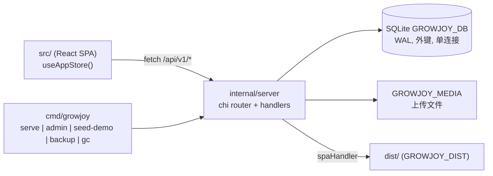

# 架构与数据流

GrowJoy 是有意做小的：**一个进程、一份 SQLite、一个媒体目录**。没有队列、没有缓存层、没有 ORM、没有 service/repository 分层。这份文档说明这样做的边界在哪里，以及改代码时哪些约束不能破。

## 运行时形态



- **单进程、单副本**：连接池是 `SetMaxOpenConns(1)`，WAL、外键与 5 秒 busy timeout 是在这一条连接上启用的。两个进程指向同一个库、或者起第二份副本，都会破坏这些前提。
- **一个数据库只服务一个家庭**：`resolvedFamily` 取 `families` 表里最早的一行，客户端无法指定家庭。多家庭请各自部署。
- **目标机不需要构建链**：本地构建 `dist/` 和静态 `linux/amd64` 二进制，只把它们传上去（见 [DEPLOY.md](../DEPLOY.md)）。
- 数据库与媒体目录在同一个卷上，必须**作为一个一致单元**备份。

## 组件与目录

只有两个非测试 Go 包：

| 位置 | 职责 |
|---|---|
| `cmd/growjoy/main.go` | 唯一入口与唯一的 `GROWJOY_*` 读取处；子命令 `serve` / `admin create-family` / `seed-demo` / `backup` / `gc`；`http.Server{ReadHeaderTimeout: 10s}` + 优雅关闭；每小时的清理 ticker |
| `internal/server/server.go` | `Config`/`Server`、`Open`/`applyMigrations`、整个 chi 路由、全部 HTTP 处理器、认证、上传、DTO、统计 |
| `internal/server/admin.go` | 非 HTTP 操作：`CreateFamily`、`SeedDemo`、`EnsureDemo` |
| `internal/server/homework.go` | 作业资源：读某一天、家长端 multipart 写入、固定学科表、图片归一化（EXIF 方向 → 最长边 2560 → JPEG q85） |
| `internal/server/ratelimit.go` | 令牌桶、家长密码失败预算、argon2 并发闸门、panic 恢复与错误辅助函数 |
| `internal/server/migrations/*.sql` | `//go:embed` 的迁移；`001_init.sql` 是 schema 唯一来源，每次启动重跑且必须幂等 |

前端只有 `src/`：`App.tsx` 装着全部组件与路由，`store.ts` 是唯一状态容器与 API 客户端，`domain.ts` 是成长日历的日期计算，`styles.css` 是全部样式。

## 请求链路

```
requestLog（安全响应头 + 一行访问日志）
  └─ recoverPanic（panic → 记录并返回 500；已写出的响应不重写）
       └─ chi mux
            ├─ /health/live, /health/ready（在 API 之外）
            └─ /api/v1（sameOrigin）
                 ├─ 公开认证路由 + authLimit：/auth/child, /auth/parent
                 └─ authenticate 组
                      ├─ 任意角色：/state, /session/child, /auth/parent/password（仅家长）…
                      └─ parentOnly：孩子 / 任务 / 愿望 / 作业的写操作
```

要点：

- **没有** CORS 头、CSRF token、超时中间件或 `Cache-Control`。CSRF 防护由 `sameOrigin` 承担：GET/HEAD/OPTIONS 直接放行；`Sec-Fetch-Site: cross-site` → `403 cross_site_request`；非空 `Origin` 的 host 与 `r.Host` 不一致 → `403 origin_mismatch`。再加上会话 cookie 的 `SameSite=Lax`。
- 因为比较的是 `Origin` 与 `r.Host`，**任何反向代理都必须保留浏览器发来的 `Host`**（nginx 要 `proxy_set_header Host $host`）。开发用的 Vite 代理因此固定 `changeOrigin: false`。
- 全部 `/api/v1` 路径都要求带尾斜杠的 `/` 形式用于创建路由，`src/store.ts` 按此构造。
- SPA 由 `spaHandler` 兜底：任何未命中的路径都返回 `index.html` 和 200，所以资源引用写错不会 404，只会白屏——改前端后必须重新构建 `dist/`。

## 数据流

- **一次请求拿全量**：`GET /api/v1/state` 返回 `State` 聚合（角色、当前孩子、孩子、任务、提交与附件、愿望、账本、兑换记录、家庭 `timezone`）。前端没有任何按资源分页或按需加载。
- **写操作返回极简结果**：成功返回 `{"id": "..."}`（200）或 204，然后 `src/store.ts` 重新拉取 `/state` 与 `/stats`。没有乐观更新，服务端是唯一真相。
- **读也会写**：`state()` 先调 `ensureInstances`，用 `INSERT OR IGNORE` 幂等地为「今天 / 本周 / 创建日」生成任务实例。因此读接口不是纯只读的，实例的生成与读取共用同一个唯一键 `UNIQUE(template_id, period_key)`。
- 列表顺序是 UI 契约：孩子、账本、兑换、提交升序；任务与愿望按 `created_at` 降序；所有切片都规范化为非 `null` 数组。
- 前端 `childTasks` 记忆化后会隐藏「已完成且早于家庭今天」的实例：任务列表表达的是「现在要做什么」，历史留在成长日历里；但任意一天的 `todo` / `pending_review` / `rejected` 仍然可见，因为家长还要处理。

## 一致性约束

并发安全全部压在 SQL 上，没有应用层锁：

| 约束 | 作用 |
|---|---|
| 每条语句都带来自会话的 `family_id`；`RowsAffected() == 0` → 404 | 防跨家庭泄漏；漏掉 `AND family_id = ?` 就是越权 |
| `point_ledger UNIQUE(family_id, reference_type, reference_id)` + `INSERT OR IGNORE` 后检查 `RowsAffected()==1` | 积分只入账一次 |
| `UPDATE ... WHERE status IN ('todo','rejected')` / `WHERE reviewed_at IS NULL` | 状态机迁移并发安全，改到 0 行就是 `409 conflict` |
| `task_instances UNIQUE(template_id, period_key)` + `INSERT OR IGNORE` | 同一天/同一周只生成一个实例 |
| `idempotency_keys PRIMARY KEY(family_id, actor_id, operation, key)` | 重放只返回历史结果，不重复副作用 |

**幂等写入**：`submit` / `review` / `redeem` / 手动加减分要求 `Idempotency-Key` 头，缺失是 `400 idempotency_required`。键作为事务的第一笔写入（`INSERT ... ON CONFLICT DO NOTHING`，哨兵 `status_code = -1`）抢占：并发同键请求只有赢家执行，输家回滚并返回已记录的状态；赢家也回滚时输家看到 `409 conflict`。前端只在失败后重放同一个键，因此重试是安全的。

**积分双记账**：账本是真相；`children.experience` 存**总经验**，接口暴露 `experience % 100` 与 `level = 1 + 总经验/100`；审批加 `max(points/5, 1)` 经验。`children.points_balance` 有 `CHECK(points_balance>=0)`，余额不会为负。

**单连接事务纪律**：池子只有一条连接，事务里访问 `s.db` 会死锁——要么用 `tx`，要么用接受 `queryer` 参数的辅助函数。关闭每个 `*sql.Rows` 之后再发下一条查询。

**错误不回显**：服务端内部错误只进日志，客户端永远收到固定的 `{"error":{"code":"internal","message":"internal server error"}}`。`problem(...)` 只用于已知的、可对用户解释的错误。

## 时间与时区

- 处理器只用 `s.now()`（可被测试替换），绝不 `time.Now()`。
- 持久化的瞬时时间统一是 UTC 的 `RFC3339Nano`；只有日期语义的值（`due_date`、`period_key`）用**家庭本地**的 `YYYY-MM-DD`。
- 日/周边界由家庭 IANA 时区（默认 `Asia/Shanghai`）决定，不是进程本地时区。可用 `GET /state` 的 `timezone` 与 `/stats` 的 `from`/`to` 对照。
- 前端所有日期展示都走 `src/domain.ts` / `dateText` 旁的 `familyToday` / `familyDate` / `weekdayOf` / `monthDayText` 等辅助函数，读家庭时区。**设备本地时间**会在上海时间的最后 8 小时里和 `due_date`、`/stats` 对不上；任何组件需要「今天」时接收 `today` / `timezone` prop，而不是自己读时钟。
- 测试通过替换 `s.now` 固定时间，且必须在写种子数据**之前**替换。

## 统计

`GET /stats` 只针对当前选中的孩子，不是家庭汇总。窗口由 `?from`/`?to` 指定（家庭本地、闭区间、默认最近 7 天、最长 92 天）：

- `totalTasks` **由任务模板推导**（`daily` 按天、`weekly` 按星期几、`once` 按创建日），因为实例只在被读取的那天/周生成，按实例计数会让历史窗口永远是 0。
- `completedTasks` 统计窗口内被确认（`approved=1`）的提交；积分收支来自同一窗口的账本。
- `daily` 每天一个桶：跨度 ≤ 14 天用 `周日..周六`，否则用 `M/D`；`categories` 由这些确认记录推导。

## 上传与媒体

- 任务提交与心愿完成：`multipart/form-data`，字段 `files`（最多 6 个）、可选 `note`（≤30 字），总预算 100 MiB。图片 jpeg/png/webp ≤10 MiB，视频 mp4/webm ≤100 MiB。
- 作业：字段 `date` / `subject` / `description` / `files` / `remove_media`，同样的张数与总量预算；不支持的格式在作业路径上会被跳过并回报，不拖垮整批。
- 类型靠**内容嗅探**（512 字节 + MP4 `ftyp`/brand、WebM EBML 探针）而不是文件名。文件先落盘到 `GROWJOY_MEDIA`（`media_<hex><ext>`，0600），再进事务；失败路径有清理闭包，提交成功后不会删。
- 读取走 `GET /api/v1/media/{id}`：要登录、按家庭隔离、`filepath.Base` 防穿越、`http.ServeContent` 支持 Range，返回 `Content-Disposition: inline`。
- `attachments` 行有 XOR 约束：要么属于提交（`submission_id`），要么属于兑换（`redemption_id`）。

## 前端结构

- `main.tsx` → `App` → `BrowserRouter` → `Shell`。`Shell` 只调用一次 `useAppStore()`，把整个 store 作为 prop 往下传；没有 Context、Redux 或按页面取数。
- 路由表：`ChildLayout`（`/child`、`/child/tasks`、`/child/homework`、`/child/wishes`、`/child/growth`）与 `ParentLayout`（`/parent`、`/parent/children`、`/parent/tasks`、`/parent/wishes`、`/parent/homework`、`/parent/stats`），未知路径回落到各自的首页。
- 家长端解锁是客户端状态（`Shell` 的 `parentGate`）+ 12 小时的服务端家长会话；刷新回到孩子端，`/parent` 深链会在解锁后被恢复。
- 作业是 `/state` 之外的第二份数据（`store.homework`，含日期与当日列表），三个写操作自己重新加载当天数据并设置成功提示。增长日历完全由 `State` 推导，不读 `/stats`。
- 样式只有一个 `src/styles.css`：每行一条压缩规则、`:root` 自定义属性、手写类名，只有 760px / 430px 两个断点。

## 明确不做的事

没有 Redis、消息队列、后台任务、ORM、GraphQL、多租户切换、离线缓存、Service Worker 或 i18n 层。任何增加这类依赖的改动都应该先论证它解决的是当前真实存在的问题。
